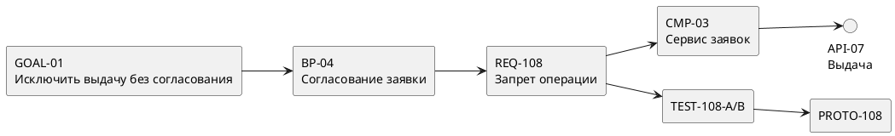

**Направление:** системный анализ · **Актуализация:** 09.10.2026.

Трассируемость — это возможность установить происхождение требования, его связи с решениями и способы подтверждения реализации. Она превращает набор разнородных артефактов — интервью, модели процессов, ТЗ, API-контракты, сценарии испытаний — в управляемую систему знаний.

## 1. Что именно требуется связать

Типовая цепочка: **потребность заказчика → шаг бизнес-процесса → требование → системный компонент → интерфейс → тест → свидетельство испытаний**. В крупных проектах добавляются регуляторное основание, модель данных, риск, задача реализации и запись об изменении.

| Артефакт | Главный вопрос | Пример кода |
|---|---|---|
| Бизнес-цель | Для чего нужно изменение? | `GOAL-01` |
| Процесс | В какой операции проявится результат? | `BP-04` |
| Требование | Что должна обеспечить система? | `REQ-108` |
| Архитектура | Какой компонент отвечает за реализацию? | `CMP-03` |
| Контракт | Через какой интерфейс доступна функция? | `API-07` |
| Испытание | Как проверяется выполнение требования? | `TEST-108` |
| Доказательство | Где записан наблюдаемый результат? | `PROTO-108` |

Наличие ссылки не означает, что требование корректно: смысл связи необходимо проверять.

## 2. Демонстрационный процесс и требование

**Вымышленная предметная область:** согласование заявок на выдачу оборудования.

Бизнес-цель: исключить выдачу оборудования по заявке, не прошедшей согласование. На этапе анализа процесса выделен переход «Согласовать заявку». После уточнения прав и состояний формулируется требование:

> `REQ-108`. При попытке операции «Выдать оборудование» система должна отказать в выполнении, если заявка не имеет статуса `approved`. Результат отказа должен содержать идентификатор операции и код ошибки `REQUEST_NOT_APPROVED`. Запись о попытке фиксируется в журнале аудита.

Это требование не равно экранной форме. Оно касается бизнес-правила, серверной проверки, API-ответа и аудита. Проверка только отображаемой кнопки не доказывает его выполнения.

## 3. Матрица прямой и обратной трассируемости

| ID требования | Процесс | Компонент | Интерфейс | Тест | Статус покрытия |
|---|---|---|---|---|---|
| REQ-108 | BP-04 | CMP-03 | API-07 | TEST-108-A, TEST-108-B | Есть позитивный и негативный путь |
| REQ-109 | BP-05 | CMP-04 | API-08 | — | **Нет испытания** |
| REQ-110 | BP-05 | CMP-05 | API-08 | TEST-110 | Требует проверки результата |

Матрица показывает две разные категории проблем: пропуск артефакта (для `REQ-109` нет теста) и некорректную связь (для `REQ-110` тест присутствует, но может не измерять требуемую характеристику).

## 4. Демонстрационный набор испытаний

**`TEST-108-A`: отказ для неподтвержденной заявки.**

1. Создать заявку `R-1001` со статусом `draft`.
2. Отправить команду выдачи оборудования с действующей ролью кладовщика.
3. Проверить, что операция не выполнена и возвращен код `REQUEST_NOT_APPROVED`.
4. Проверить журнал аудита: запись содержит заявку, исполнителя, время и результат отказа.

**`TEST-108-B`: выполнение для подтвержденной заявки.**

1. Перевести заявку `R-1001` в `approved` установленным способом.
2. Повторить команду с разрешенной учетной записью.
3. Проверить успешное изменение состояния и отсутствие повторной выдачи при повторе запроса, если это предусмотрено отдельным требованием об идемпотентности.

Тесты проверяют разные ветви бизнес-правила; позитивный тест не компенсирует отсутствие негативного.

## 5. Схема зависимостей в PlantUML




Исходный код схемы пригоден для хранения в Git рядом со статьей. Для производственной документации следует выбирать строгий тип связи («порождает», «реализует», «проверяет») и указывать направление.

## 6. Анализ влияния изменений

Предположим, разрешено выдавать оборудование также по заявкам в состоянии `conditionally_approved`. После регистрации изменения `CR-014` аналитик должен найти все зависящие от `REQ-108` элементы: бизнес-правило, API-контракт, таблицу переходов состояний, аудит, тесты, руководство оператора.

При изменении только серверного кода документация и испытания станут устаревшими. При изменении только текста требования тесты перестанут служить доказательством актуального поведения. Поэтому связь должна поддерживаться при каждом утвержденном изменении.

## 7. Типовые правила автоматического контроля

```text
Правило TR-01: каждое обязательное требование имеет источник.
Правило TR-02: каждое принятое требование имеет владельца.
Правило TR-03: каждое реализуемое требование связано с компонентом.
Правило TR-04: каждое проверяемое требование имеет хотя бы один тест.
Правило TR-05: каждый завершенный тест имеет свидетельство исполнения.
Правило TR-06: нет ссылок на удаленные идентификаторы.
```

Автоматическая проверка этих правил обнаруживает структурные разрывы. Оценка полноты самих требований остается задачей аналитика и предметного эксперта.

## Вывод

Трассируемость обеспечивает управляемость изменений и защищаемость приемки. Ее ценность проявляется тогда, когда можно быстро объяснить, **почему** реализована конкретная функция, **каким** требованием она задана и **чем** доказан результат.

## Источники

1. [ГОСТ 34.602-2020: ТЗ на создание АС](https://protect.gost.ru/gost/details/5876f733-ee91-431a-8cb6-9e02ea2436ac).
2. [ГОСТ Р 59792-2021: виды испытаний АС](https://protect.gost.ru/gost/details/60279c95-21dc-430c-bf2c-f626c588576e).
3. [OMG BPMN 2.0.2](https://www.omg.org/spec/BPMN/) — описание бизнес-процессов.
4. [OMG UML 2.5.1](https://www.omg.org/spec/UML/) — модели компонентов и взаимодействий.

*Все бизнес-сценарии и идентификаторы демонстрационные.*
