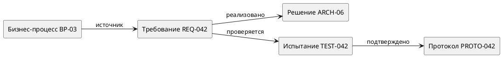

<!-- SYNTHETIC_DATE_FOR_DEMO -->
> **Условная дата:** дата этой статьи создана для демонстрационной хронологии сайта. Фактическая дата написания или публикации не подтверждена.

**Направление:** системный анализ · **Актуализация:** 09.10.2026 · **Формат:** методика с матрицей трассируемости.

Техническое задание (ТЗ) определяет согласованные требования к автоматизированной системе. Программа и методика испытаний (ПМИ) определяет, **как и на основании каких свидетельств** устанавливается соответствие системы этим требованиям. Если два документа разрабатываются независимо, возникает типовая проблема: в ТЗ присутствуют непроверяемые формулировки, а в ПМИ — тесты, не подтверждающие ни одного конкретного требования.

## 1. Нормативная рамка на 2026 год

При разработке документации АС в Российской Федерации необходимо различать четыре области:

| Предмет регулирования | Актуальный документ | Основное назначение |
|---|---|---|
| ТЗ на АС | ГОСТ 34.602-2020 | Состав, содержание и оформление технического задания |
| Виды, комплектность и обозначения документации | ГОСТ 34.201-2020 | Перечень и идентификация документов |
| Виды испытаний АС | ГОСТ Р 59792-2021 | Виды испытаний и общие требования к проведению |
| Содержание документов АС | ГОСТ Р 59795-2021 | Требования к содержанию документации |

ГОСТ 34.602-89 заменен ГОСТ 34.602-2020. ГОСТ 34.603-92 **утратил силу в РФ**, вместо него применяется ГОСТ Р 59792-2021. Использовать прежние редакции в качестве актуального нормативного основания без отдельного обоснования некорректно.

## 2. От пожелания к проверяемому требованию

Сравнение исходной и нормализованной формулировок:

> Исходное пожелание: «Отчеты должны быстро выгружаться и быть удобными».

Пожелание содержит неопределенные слова и не задает условий проверки. Возможная переработка для **демонстрационной** системы:

> `REQ-042`. При выборе команды «Экспорт» система должна формировать файл CSV объемом не менее 10 000 строк не более чем за 8 с в контрольной среде `ENV-01`. Кодировка файла — UTF-8; первая строка содержит наименования колонок.

В реальном проекте числовой порог, нагрузка, ресурсы и формат согласуются с заказчиком; здесь они учебные. Требование стало конкретным, измеримым и снабженным проверяемыми условиями.

## 3. Матрица трассируемости

Связи рекомендуется вести по устойчивым идентификаторам, а не по номерам страниц: нумерация разделов меняется при редактировании, идентификаторы требований — только по управляемой процедуре.

| Требование | Источник | Проектное решение | Испытание | Свидетельство |
|---|---|---|---|---|
| REQ-042 | BP-03 «Получить выгрузку» | ARCH-06 «Сервис экспорта» | TEST-042 | PROTO-042 |
| REQ-043 | SEC-02 «Доступ по роли» | ARCH-07 «Проверка полномочий» | TEST-043 | PROTO-043 |
| REQ-044 | OPS-05 «Резервное восстановление» | ARCH-08 «Снимок БД» | TEST-044 | PROTO-044 |

**Прямой контроль:** у каждого обязательного требования есть метод проверки. **Обратный контроль:** каждый приемочный тест опирается на требование. Это позволяет выявить как непроверенные требования, так и произвольные испытания.

## 4. ПМИ: сценарий, а не перечень нажатий

Для каждого теста необходимы как минимум объект, цель, условия, подготовка, последовательность действий, ожидаемый результат, способ фиксации и критерий успешности. Дополнительно задаются участники, контрольная версия ПО, исходные данные, условия завершения и порядок регистрации отклонений.

**Пример `TEST-042` (вымышленный):**

| Поле | Содержание |
|---|---|
| Проверяемое требование | `REQ-042` |
| Объект | Модуль формирования отчетов версии 1.0 |
| Начальные условия | Учетная запись с ролью «Аналитик»; набор `DATA-042` содержит 10 000 строк |
| Действия | Авторизоваться; открыть отчет; выполнить «Экспорт CSV»; зафиксировать длительность |
| Ожидаемый результат | Файл сохранен, UTF-8, заголовки присутствуют, строк данных — 10 000, время ≤ 8 с |
| Доказательства | Журнал выполнения, выгруженный файл, протокол замера, версия стенда |
| Критерий | Все условия выполнены; иначе замечание с фактическим результатом |

Нельзя заменять критерий фразой «работает корректно»: такая формулировка не доказывает соответствие измеримому параметру.

## 5. Управление изменениями требований

Если заказчик меняет порог `REQ-042` с 8 до 5 с, изменение затрагивает не только ТЗ. Подлежат пересмотру `TEST-042`, требования к контрольной среде, показатели протоколов и при необходимости архитектурные решения. Формируется запись об изменении с датой, причиной, инициатором, влиянием и статусом согласования.

Для полноты полезна схема:

## 6. Распространенные дефекты

| Дефект | Последствие | Корректирующее действие |
|---|---|---|
| Требование без единицы измерения | Неоднозначный результат | Указать показатель и единицу |
| Тест без начальных условий | Невоспроизводимость | Зафиксировать стенд, версию, данные |
| Разные версии системы в ТЗ и ПМИ | Невозможно установить объект приемки | Ввести единый реестр конфигурации |
| Тестов меньше, чем обязательных требований | Пробелы приемки | Анализ покрытия и исключений |
| Исправление требования без пересмотра тестов | Ложная готовность | Процедура анализа влияния изменений |

## 7. Что является готовым результатом

Качественный результат — это согласованный комплект, в котором каждое требование имеет источник и способ проверки, а каждое решение и испытание можно связать с конкретной версией системы. Статус «проверено» допустим только при наличии зарегистрированного свидетельства.

## Вывод

Связка ТЗ, ПМИ и реестра требований образует основу защищаемой приемки: документ определяет ожидаемое поведение, испытание — способ его проверки, а протокол — зарегистрированный фактический результат.

## Источники

1. [ГОСТ 34.602-2020 — Росстандарт](https://protect.gost.ru/gost/details/5876f733-ee91-431a-8cb6-9e02ea2436ac).
2. [ГОСТ 34.201-2020 — Росстандарт](https://protect.gost.ru/gost/details/765f2a29-e368-4e1e-9eed-aeb1dc36a924).
3. [ГОСТ Р 59792-2021 — Росстандарт](https://protect.gost.ru/gost/details/60279c95-21dc-430c-bf2c-f626c588576e).
4. [ГОСТ Р 59795-2021 — Росстандарт](https://protect.gost.ru/gost/details/29834ae6-3ac4-4f76-859f-7704ed07f1c8).
5. [ГОСТ 34.603-92: утратил силу в РФ](https://protect.gost.ru/gost/details/509c908a-b61f-4969-a998-f3e684700638).

*Все идентификаторы, значения и испытания в примере демонстрационные.*
