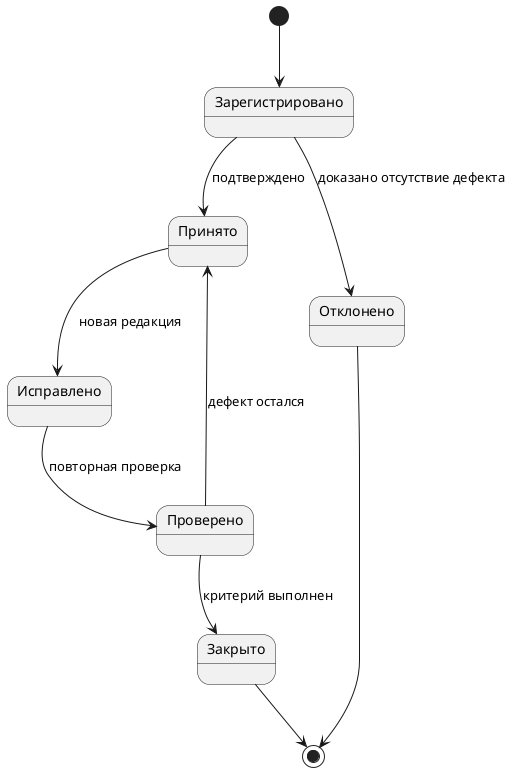

<!-- SYNTHETIC_DATE_FOR_DEMO -->
> **Условная дата:** дата этой статьи создана для демонстрационной хронологии сайта. Фактическая дата написания или публикации не подтверждена.

**Направление:** техническое документирование, нормоконтроль · **Актуализация:** 09.10.2026.

Замечание полезно лишь тогда, когда его можно воспроизвести, локализовать, исправить и закрыть по понятному критерию. Формулировка «исправить оформление» не определяет ни дефект, ни ожидаемый результат. Профессиональная таблица замечаний должна служить единым журналом обнаружения, устранения и повторной проверки отклонений.

## 1. Четыре уровня качества

| Уровень | Проверяемый предмет | Пример |
|---|---|---|
| Нормативный | Правила оформления, обязательные реквизиты | Отсутствует обозначение документа |
| Структурный | Разделы, ссылки, состав поставки | В перечне есть отсутствующее приложение |
| Технический | Функции, параметры, интерфейсы, версии | Разные порты сервиса в двух инструкциях |
| Эксплуатационный | Полнота операций для пользователя | Не описано восстановление после ошибки |

Грамматическая корректность является необходимой, но недостаточной составляющей качества.

## 2. Структура записи о замечании

Минимальный набор полей журнала:

| Поле | Правило заполнения |
|---|---|
| Идентификатор | Устойчивый код `DOC-001` |
| Документ и редакция | Однозначное имя и версия проверяемого файла |
| Локализация | Раздел, страница, таблица, рисунок, текстовый якорь |
| Фактическое состояние | Что обнаружено, по возможности дословно |
| Ожидаемое состояние | Какой результат должен быть достигнут |
| Основание | Пункт согласованного требования, НД или решение проекта |
| Приоритет | Критический, высокий, обычный — по принятой модели |
| Ответственный и срок | Исполнитель и контрольная дата |
| Статус | Зарегистрировано, принято, исправлено, проверено, закрыто |
| Доказательство закрытия | Файл, редакция, ссылка на проверку или протокол |

**Правило атомарности:** одно замечание — один независимо проверяемый дефект. Если в одной строке смешаны три разных несоответствия, невозможно корректно присвоить единый статус исправления.

## 3. Демонстрационный пример: дефект технических параметров

**Плохая запись:** «В руководстве неправильный порт».

**Проверяемая запись:**

| Атрибут | Значение |
|---|---|
| Код | `DOC-021` |
| Документ | `Admin_Guide_v08.docx`, раздел 5.2 |
| Факт | «Веб-интерфейс доступен по порту 8080» |
| Основание | Архитектурная ведомость `NET-03`, редакция 04 |
| Ожидается | «Веб-интерфейс доступен по порту 8081» |
| Проверка | Сверить инструкцию, схему развертывания и фактическую конфигурацию стенда |
| Закрытие | Исправлена редакция 09; контроль конфигурации проведен |

Все номера и названия демонстрационные. Существенный момент — **основание нельзя считать достоверным только потому, что оно записано в соседнем документе**. При расхождении следует определить авторитетный источник, подтвердить его у разработчика и только затем менять текст.

## 4. Жизненный цикл замечания

Переход «Исправлено → Закрыто» без проверки недопустим в методике строгого контроля: исполнитель правки и проверяющий могут наблюдать разные результаты.

## 5. Регрессионный контроль

Регрессия в документации возникает, когда устранение одного дефекта приводит к новому: например, замена скриншота удаляет подпись, исправление обозначения разрывает перекрестные ссылки, перенос приложения изменяет нумерацию разделов.

Последовательность регрессионной проверки:

1. Зафиксировать исходную редакцию и содержание замечания.
2. Определить связанные документы, таблицы, схемы и ссылки.
3. Выполнить правку в исходнике и сохранить новую редакцию.
4. Проверить исходный дефект и все затронутые зависимости.
5. Пересобрать производные форматы (PDF, HTML) и сверить их с исходником.
6. Зафиксировать закрытие в журнале с указанием доказательств.

## 6. Метрики качества, которые можно защищать

Вместо субъективной формулы «качество улучшилось» допускается применять измеримые показатели:

- **Доля закрытых замечаний** — число проверенно закрытых / число принятых замечаний за выбранный период.
- **Доля повторно открытых замечаний** — число переоткрытых / число проверенных замечаний.
- **Плотность замечаний** — число зарегистрированных замечаний на 100 страниц либо на документ заданного вида; сравнение допустимо только при сопоставимой методике контроля.
- **Полнота контроля** — число проверенных документов / число документов контрольного перечня.

Ни одна из этих метрик сама по себе не подтверждает техническую правильность продукта. Для обоснованных выводов необходимы контекст, единая методика регистрации и одинаковая сложность проверяемых материалов.

## 7. Приемочный чек-лист

- Замечания содержат точную локализацию и критерий закрытия.
- Основания не противоречат действующим требованиям и исходным сведениям.
- Для каждого исправления известна редакция документа.
- Статус «Закрыто» присвоен только после независимой повторной проверки.
- По измененным значениям проверены все зависимые документы.
- Файлы проверки не раскрывают непубличные данные заказчика.

## Вывод

Таблица замечаний — элемент инженерного управления качеством, а не список претензий к автору. При правильно заданных состояниях, основаниях и доказательствах она снижает неопределенность приемки и позволяет организовать воспроизводимый контроль больших комплектов.

## Методические источники

1. [ГОСТ 34.201-2020: комплектность и обозначение документов](https://protect.gost.ru/gost/details/765f2a29-e368-4e1e-9eed-aeb1dc36a924).
2. [ГОСТ 19.101-2024: виды программных документов](https://protect.gost.ru/gost/details/5cee0533-a1f4-41fe-bcb3-bc79e7e74490).
3. [Microsoft Learn: обновление полей Word](https://learn.microsoft.com/en-us/office/vba/api/word.fields.update).

*Предложенная схема статусов и метрик — авторская методика контроля, а не буквальные обязательные правила ГОСТ.*
