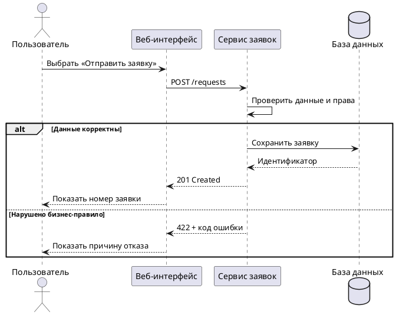
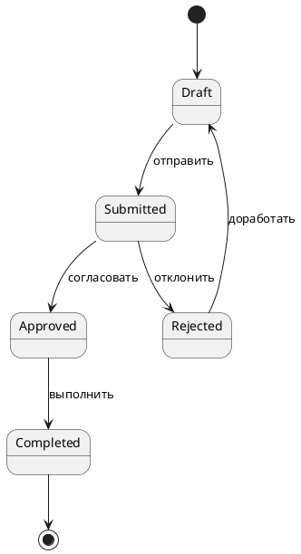

<!-- SYNTHETIC_DATE_FOR_DEMO -->
> **Условная дата:** дата этой статьи создана для демонстрационной хронологии сайта. Фактическая дата написания или публикации не подтверждена.


**Направление:** системный анализ, архитектура · **Актуализация:** 09.10.2026.

Диаграмма должна отвечать на конкретный аналитический вопрос. Если на одной схеме одновременно пытаются показать роли, серверы, статусы, сети и данные, ее детализация возрастает, а понятность снижается. Профессиональный подход состоит в выборе **модели по задаче**, согласовании границ и хранении редактируемого исходника.

## 1. Разделение ответственности нотаций

| Вопрос | Предпочтительный подход | Типовая диаграмма |
|---|---|---|
| Кто выполняет действие и по какому процессу? | BPMN | Процесс с дорожками и событиями |
| Какие сущности существуют и как связаны? | UML | Классы |
| Как взаимодействуют компоненты во времени? | UML | Последовательность |
| Какие состояния допустимы и как меняются? | UML | Диаграмма состояний |
| Из каких узлов и компонентов состоит решение? | UML / архитектурная нотация | Компоненты, развертывание |
| Как удобно хранить текстовый исходник схемы? | PlantUML | Генерация поддерживаемых видов диаграмм |

**Важно:** PlantUML — инструмент текстового задания диаграмм, а не самостоятельный стандарт, эквивалентный BPMN или UML. Обозначение обычного блок-схемного рисунка как BPMN без соблюдения семантики BPMN вводит читателя в заблуждение.

## 2. Метод выбора схемы

Вначале формулируется вопрос (например, «как происходит подача заявки?»), затем устанавливаются границы (от авторизации до получения результата), аудитория, необходимый уровень детализации и авторитетные источники. Только после этого выбираются элементы модели.

Пример критерия готовности: по диаграмме последовательности разработчик должен определить инициатора каждого вызова, адресата, условие ветвления, ожидаемый ответ и характер синхронности взаимодействия.

## 3. Демонстрационный пример UML: последовательность подачи заявки




Здесь показаны участники, вызовы и альтернативные ветви. Вместе с тем диаграмма не определяет поля запроса и ответа: для этого требуется API-контракт.

## 4. Демонстрационный пример UML: состояние заявки




Две диаграммы описывают одну предметную область с разных сторон. Диаграмма последовательности отвечает на вопрос «кто кому сообщает», диаграмма состояний — «какой переход допустим».

## 5. Как корректно применять BPMN

Для процесса согласования заявки BPMN-модель может содержать стартовое событие «Заявка поступила», пользовательские задачи «Проверить заявку» и «Принять решение», исключающую развилку по условию согласования, конечные события «Согласована» и «Отклонена». Пулы и дорожки используются, когда требуется показать ответственность участников.

При проектировании BPMN следует отдельно проверить:

- условия выхода из каждой развилки и семантику потоков;
- существование обработчика ошибок и исключительных ситуаций;
- различие потока последовательности и потока сообщений;
- соответствие дорожек реальным исполнителям;
- возможность объяснить процесс неспециалисту без устных комментариев.

Для строгой BPMN-модели следует использовать совместимый редактор, экспортирующий BPMN 2.0 XML. Обычный граф PlantUML с ромбами не следует выдавать за валидный BPMN XML.

## 6. Исходники схем как часть поставки

Рекомендуемая структура каталога:

```text
diagrams/
  request-sequence.puml
  request-states.puml
  approval-process.bpmn
  exported/
    request-sequence.svg
    request-states.svg
  README.md
```

У каждого исходника фиксируются редакция, автор/ответственный, ссылка на требование, инструмент генерации и дата изменения. Для воспроизводимой сборки желательно закреплять версию PlantUML и проверять доступность шрифтов в целевой среде.

## 7. Контроль связности моделей

Если диаграмма состояний запрещает операцию из `Rejected`, а описание API ее разрешает, ошибка не устраняется улучшением графического оформления. Аналитик должен установить источник расхождения, согласовать правило, обновить обе модели и добавить проверку негативного сценария.

## Вывод

Визуальное моделирование — инструмент устранения неоднозначности, а не украшение документа. Экспертность проявляется в обоснованном выборе нотации, корректности ее семантики и связности схем с требованиями и контрактами.

## Источники

1. [OMG: BPMN 2.0.2](https://www.omg.org/spec/BPMN/).
2. [OMG: UML 2.5.1](https://www.omg.org/spec/UML/).
3. [PlantUML: диаграммы последовательности](https://plantuml.com/en/sequence-diagram).

*Приведенные примеры представляют демонстрационную систему, не связанную с действующими заказчиками.*
