**Категория:** системный анализ, архитектура программного обеспечения, техническая документация.  
**Для кого:** системные аналитики, архитекторы, разработчики, тестировщики и технические писатели.  
**Дата редакции:** 09.10.2026.

## Введение

На UML-диаграммах линии показывают отношения между элементами модели, сообщения между участниками взаимодействия, переходы между состояниями, потоки управления и другие конструкции. Ошибка при чтении линии может привести к неверному пониманию архитектуры, требований или сценария выполнения системы.

Часто используется упрощённое правило: **сплошная линия обозначает ассоциацию, пунктирная — зависимость**. Для диаграммы классов это полезный ориентир, но он не является универсальным. Значение определяется одновременно **типом диаграммы, начертанием линии, наконечником стрелки, обозначениями на концах и текстовыми метками**.

Например, на диаграмме классов сплошная линия с незакрашенным треугольником означает *обобщение* (наследование), а пунктирная с таким же треугольником — *реализацию*. На диаграмме последовательности пунктирная горизонтальная стрелка часто обозначает *ответ на сообщение*, а вертикальная пунктирная линия — *линию жизни участника*. Поэтому определять отношение исключительно по наличию или отсутствию пунктира нельзя.

> **Основной принцип:** читать обозначение как единый графический знак, а не как отдельный отрезок линии.

## 1. Основные линии и графические обозначения

### 1.1. Справочная таблица

В таблице приведены распространённые обозначения и их представление в PlantUML. Синтаксис PlantUML является способом построения изображения, а не текстовой записью стандарта UML. Запись зависит от выбранного типа диаграммы.

| № | Начертание и завершение линии | Значение | Где применяется | Пример PlantUML |
|---|---|---|---|---|
| 1 | Сплошная без стрелки | Ассоциация | Диаграмма классов | `A -- B` |
| 2 | Сплошная с открытой стрелкой | Направленная навигация по ассоциации; на других диаграммах может означать поток или переход | Классы, активности, состояния | `A --> B` |
| 3 | Сплошная с пустым треугольником | Обобщение (*generalization*), в том числе наследование классов | Классы, варианты использования | `Parent <|-- Child` |
| 4 | Сплошная с пустым ромбом | Разделяемая агрегация (*shared aggregation*) | Диаграмма классов | `Whole o-- Part` |
| 5 | Сплошная с закрашенным ромбом | Композиция (*composite aggregation*) | Диаграмма классов | `Whole *-- Part` |
| 6 | Пунктирная со стрелкой | Зависимость (*dependency*) | Классы, компоненты, пакеты | `Client ..> Supplier` |
| 7 | Пунктирная с пустым треугольником | Реализация (*realization*), в частном случае — реализация интерфейса | Классы, компоненты | `Implementation ..|> Interface` |
| 8 | Пунктирная стрелка с `«include»` | Включение поведения другого варианта использования | Варианты использования | `Base ..> Included : <<include>>` |
| 9 | Пунктирная стрелка с `«extend»` | Расширение базового варианта использования | Варианты использования | `Extension ..> Base : <<extend>>` |
| 10 | Пунктирная стрелка с `«import»`, `«access»` или `«merge»` | Импорт, доступ или объединение содержимого пакетов; значения различаются | Диаграмма пакетов | `P1 ..> P2 : <<import>>` |
| 11 | Сплошная горизонтальная стрелка с закрашенным наконечником | Синхронный вызов | Диаграмма последовательности | `A -> B : operation()` |
| 12 | Сплошная горизонтальная стрелка с открытым наконечником | Асинхронное сообщение | Диаграмма последовательности | `A ->> B : event` |
| 13 | Пунктирная горизонтальная стрелка | Ответ (*reply*) в обычной записи | Диаграмма последовательности | `B --> A : result` |
| 14 | Вертикальная линия, обычно пунктирная | Линия жизни (*lifeline*), а не зависимость | Диаграмма последовательности | Генерируется для `participant` |
| 15 | Сплошная линия между узлами | Возможный путь взаимодействия (*communication path*) | Диаграмма развёртывания | `Node1 -- Node2` |
| 16 | Сплошная стрелка с подписью события или условия | Переход состояния | Диаграмма состояний | `Draft --> Approved : approve` |
| 17 | Сплошная стрелка между действиями | Поток управления или поток объектов | Диаграмма активности | Создаётся между действиями |
| 18 | Штриховая линия к примечанию | Связь графического комментария с элементом, без самостоятельного отношения предметной области | Многие UML-диаграммы | `note right of A` |
| 19 | Штриховая линия к классу-ассоциации | Присоединение класса-ассоциации к самой ассоциации | Диаграмма классов | Зависит от средства моделирования |
| 20 | Зигзагообразная линия | Прерывающее ребро (*interrupting edge*) соответствующей области | Диаграмма активности | Зависит от средства моделирования |

**Важное замечание.** Цвет, толщина и нестандартная штриховка иногда применяются как авторские средства выделения. Без легенды они не образуют нового нормативного вида отношения UML. В PlantUML можно создать пунктирную или точечную стрелку ради оформления, но это не означает автоматического изменения семантики модели.

## 2. Сплошные линии на диаграмме классов

### 2.1. Ассоциация (*association*)

**Ассоциация** означает, что экземпляры классификаторов могут быть связаны отношением, определённым моделью. На диаграмме классов обычно отображается сплошной линией. Например, пользователь оформляет заказы:

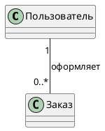


В данном случае `1` и `0..*` — **кратности концов ассоциации**, а не характеристики начертания линии. Каждый заказ связан с одним пользователем, при этом пользователь может быть связан с нулём или несколькими заказами. Это правила демонстрационной модели, а не утверждение об устройстве любой системы заказов.

**Ограничение интерпретации:** ассоциация сама по себе не доказывает, что один класс обязательно хранит поле-ссылку на другой. Такая реализация возможна, но UML описывает отношение модели, а не единственный вариант программной реализации. Отсутствие стрелок навигации также не следует автоматически трактовать как гарантированную двунаправленность: часть инструментов скрывает сведения о навигируемости.

### 2.2. Направленная навигация

Открытая стрелка на конце сплошной ассоциации может показывать **навигацию** — возможность перехода от экземпляра одного класса к связанному экземпляру другого.

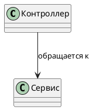


Навигация не тождественна направлению передачи сообщений или вызову метода. Для поведения во времени следует использовать диаграмму последовательности, а не пытаться выразить все вызовы стрелками на диаграмме классов.

### 2.3. Обобщение (*generalization*)

Сплошная линия с **незакрашенным треугольником** обозначает отношение общего и специализированного классификаторов. Треугольник направлен **к более общему элементу**.

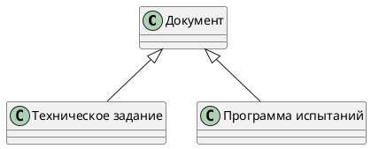


Смысл: специализированные элементы обладают характеристиками, предусмотренными общим классификатором, с возможностью дальнейшего уточнения. В коде такое отношение часто соответствует наследованию, но семантика модели не обязана полностью совпадать с конкретным механизмом языка программирования.

### 2.4. Агрегация (*shared aggregation*)

Агрегация относится к отношениям «целое — часть» и обозначается **пустым ромбом у целого**. Обычно применяется там, где часть может участвовать в нескольких отношениях или сохранять самостоятельность.

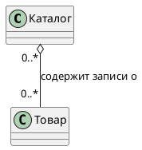


Значение разделяемой агрегации в UML намеренно оставляет возможности для уточнения в предметной области. Поэтому **пустой ромб не следует добавлять исключительно потому, что один элемент на словах «содержит» другой**. Во многих случаях обычная ассоциация будет точнее.

### 2.5. Композиция (*composition*)

Композиция обозначается **закрашенным ромбом у целого** и выражает более строгую модель владения частями. В конкретный момент часть может относиться не более чем к одному составному целому в рамках одной композиции. Создание и уничтожение частей определяется семантикой композиции и моделью жизненного цикла; не следует сводить всё к формуле «часть физически не может существовать отдельно».

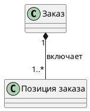


Если позиция заказа не имеет самостоятельного смысла вне конкретного заказа и её жизненный цикл управляется заказом, композиция может быть обоснованным выбором. Если объект может свободно переходить между несколькими владельцами, требуется уточнить модель.

**Практическое правило:** выбирать композицию и агрегацию по правилам владения, кратности и жизненного цикла, а не по субъективной «силе» графической связи.

## 3. Пунктирные линии на диаграмме классов

### 3.1. Зависимость (*dependency*)

Пунктирная линия с **открытой стрелкой** выражает зависимость: изменение элемента, к которому направлена стрелка, потенциально может затронуть зависимый элемент. Стрелка направлена **от клиента зависимости к поставщику**.

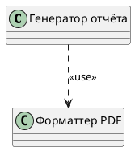


Типичные основания для зависимости: использование параметра метода, типа возвращаемого значения, локальной переменной, вызов внешней операции или обращение к сервису. **Но зависимость не обязана быть исключительно временной или менее важной для работы системы.**

### 3.2. Реализация (*realization*)

Пунктирная линия с **незакрашенным треугольником** показывает, что один элемент реализует спецификацию другого. Частный случай — класс, реализующий интерфейс. Треугольник направлен **к спецификации или интерфейсу**.

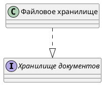


Отличие от обобщения определяется **сочетанием линии и наконечника**: `--|>` — сплошное обобщение, `..|>` — пунктирная реализация в принятой здесь записи PlantUML.

### 3.3. Линии примечаний и классов-ассоциаций

Пунктир не всегда означает зависимость. Штриховая линия может просто связывать примечание с комментируемым элементом. Ещё один частный случай — **класс-ассоциация**: его прямоугольник присоединяется штриховой линией к обозначению ассоциации, характеристики которой моделируются отдельным классом. Это **не** означает, что такой класс «слабо зависит» от ассоциации.

## 4. Варианты использования: связи акторов и сценариев

На диаграмме вариантов использования часто встречаются три внешне похожих обозначения, которые описывают разные отношения:

| Отношение | Линия | Куда направлена стрелка | Смысл |
|---|---|---|---|
| Ассоциация актора с вариантом использования | Обычно сплошная | Часто без стрелки | Актор участвует во взаимодействии с системой |
| `«include»` | Пунктирная с открытой стрелкой | От включающего варианта к включаемому | Поведение включаемого варианта используется как часть базового |
| `«extend»` | Пунктирная с открытой стрелкой | От расширяющего варианта к расширяемому | Дополнительное поведение включается при предусмотренных условиях и в точках расширения |
| Обобщение акторов или вариантов использования | Сплошная с пустым треугольником | К более общему элементу | Специализация общего актора или варианта |

Пример:

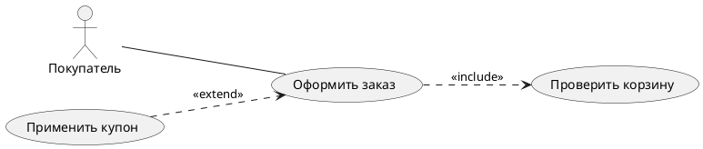


В примере проверка корзины вынесена как включаемое поведение; применение купона представлено как возможное дополнение. В реальном проекте необходимы условия расширения и описание поведения вариантов использования. **Нельзя менять направления стрелок `include` и `extend` по соображениям удобства компоновки рисунка.**

## 5. Диаграмма последовательности: вызовы, сигналы и ответы

На диаграмме последовательности горизонтальные линии отображают **сообщения между линиями жизни**. Их назначение связано с типом сообщения, а не с определённой «прочностью» связи.

| Обозначение | Значение | Примечание |
|---|---|---|
| Сплошная стрелка с закрашенным наконечником | Синхронный вызов | Отправитель ожидает завершения соответствующего вызова |
| Сплошная стрелка с открытым наконечником | Асинхронный вызов или сигнал | Отправка не требует ожидания завершения обработки как для синхронного вызова |
| Пунктирная стрелка с открытым наконечником | Ответ (*reply*) | Может показывать возвращаемое значение или результат |
| Вертикальная линия под участником | Линия жизни (*lifeline*) | Обычно штриховая; обозначает существование участника в рассматриваемом взаимодействии |
| Узкий вертикальный прямоугольник на линии жизни | Интервал выполнения (*execution specification*) | Обозначает выполнение поведения или ожидание в рамках взаимодействия |
| Крест `X` внизу линии жизни | Уничтожение экземпляра | Не следует путать с отказом операции или ошибкой |

Пример: API принимает запрос, отправляет сообщение в очередь и возвращает клиенту подтверждение приёма.

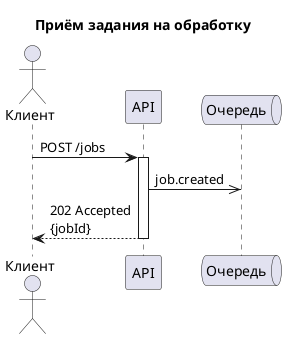


**Важно:** код HTTP `202 Accepted` не гарантирует выполнения задания. Он сообщает о принятии запроса на обработку. Наличие ответа HTTP не превращает асинхронную последующую обработку в синхронную. Реальные гарантии доставки, повторов и завершения следует описывать отдельно.

В PlantUML **одинаковый текст стрелки может означать разное в разных видах диаграмм**. Например, `-->` на диаграмме классов обычно создаёт *сплошную* направленную связь, а на диаграмме последовательности — *пунктирную* стрелку сообщения. Поэтому переносить «словарь стрелок» из одного синтаксического контекста в другой без проверки нельзя.

## 6. Диаграммы активности: потоки управления и объектов

На диаграмме активности стрелки чаще показывают **передвижение маркеров управления или объектов**, а не отношения классов.

- **Поток управления (*control flow*)** определяет последовательность выполнения действий.
- **Поток объектов (*object flow*)** передаёт объекты или данные между узлами активности.
- **Условия перехода (*guards*)** размещаются возле исходящих рёбер ветвления, обычно в квадратных скобках.
- **Узел решения и узел слияния** изображаются ромбом; они определяются ролью в потоке, а не наличием композиции.
- **Узлы разделения и объединения параллельных потоков** изображаются утолщённой полосой (*fork/join*). Это не «особо сильная линия отношения».
- **Прерывающее ребро** в соответствующем контексте может иметь зигзагообразное обозначение.

Пример:

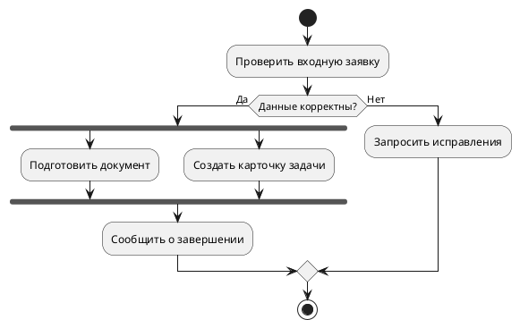


PlantUML может позволять изменять стиль линий активности на `dashed`, `dotted` или `bold`, однако **одно только применение такого стиля не превращает ребро управления в UML-зависимость**. Семантика задаётся узлами и отношением потока.

## 7. Диаграмма состояний: переходы и события

На диаграмме состояний сплошная направленная линия обычно представляет **переход** от одного состояния к другому. Подпись может включать событие, условие допуска и действие в форме:

`событие [условие] / действие`

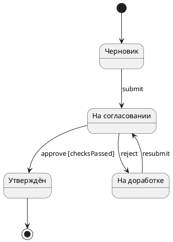


Переход обозначает **изменение состояния в ответ на событие или условие**. Это не ассоциация между классами. Если инструмент изменяет его цвет или штриховку, смысл изменения должен поясняться в легенде, а не предполагаться по аналогии с зависимостями.

## 8. Компоненты, пакеты и развёртывание

### 8.1. Компоненты

Для компонентов применяются уже рассмотренные общие UML-отношения: зависимости, реализации и ассоциации. Дополнительно могут использоваться **предоставляемые интерфейсы** (кружок, *lollipop*) и **требуемые интерфейсы** (полукруг, *socket*). Их соединение образует **сборочный соединитель** (*assembly connector*), который имеет собственную семантику. Это не просто «сплошная линия между двумя прямоугольниками».

Если на схеме требуется показать, **какой именно контракт** предоставляет компонент и какой контракт использует другой компонент, целесообразно подписывать интерфейсы и пояснять протоколы обмена.

### 8.2. Пакеты

На диаграммах пакетов пунктирные стрелки с ключевыми словами `«import»`, `«access»` и `«merge»` обозначают разные отношения, а не общий «пунктир между папками». Например, импорт пакета может делать его публичные элементы доступными в пространстве имён импортирующего пакета; объединение пакетов имеет другую семантику.

### 8.3. Развёртывание

Сплошная линия между узлами развёртывания обычно обозначает **путь коммуникации (*communication path*)**, а не вызов метода. Пунктирная стрелка к артефакту, компоненту или узлу может изображать соответствующую **зависимость**, если она оформлена по UML и имеет необходимую метку.

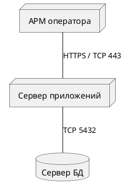


Протоколы и порты здесь приведены **как условный пример проектной модели**. Наличие подписи `HTTPS` не доказывает, что соединение действительно защищено: это необходимо подтверждать конфигурацией и испытаниями.

## 9. Кратности, названия ролей и дополнительные обозначения

Полное прочтение ассоциации требует учитывать не только линию, но и подписи рядом с её концами.

| Обозначение | Смысл |
|---|---|
| `1` | Ровно один экземпляр |
| `0..1` | Ноль или один экземпляр |
| `*` или `0..*` | Ноль или более экземпляров |
| `1..*` | Один или более экземпляров |
| `2..5` | От двух до пяти экземпляров |
| Имя возле конца ассоциации | Имя роли, выполняемой соответствующим концом |
| `«stereotype»` | Уточнение типа элемента или отношения предусмотренным механизмом стереотипов либо ключевых слов |
| `{ordered}`, `{unique}` и другие ограничения | Дополнительные ограничения на соответствующее свойство или модель |
| Название отношения по центру линии | Семантическое наименование ассоциации, например «выполняет», «содержит», «оформляет» |

Если кратность или направление на диаграмме не указаны, не следует **автоматически придумывать** их на основании особенностей используемого языка программирования либо библиотеки диаграмм.

## 10. Чем UML отличается от ER-диаграмм

**ER-диаграммы не являются разновидностью UML-диаграмм классов.** Хотя оба способа визуализации показывают сущности и связи, их семантика и правила оформления различаются.

В некоторых распространённых вариантах ER-нотации, включая *identifying / non-identifying relationships*, принято различать:

- **Идентифицирующую связь (*identifying*)**: ключ родительской сущности участвует в идентификаторе дочерней; в соответствующих инструментах часто показывается сплошной линией.
- **Неидентифицирующую связь (*non-identifying*)**: внешний ключ используется для связи, но не входит в первичный ключ дочерней сущности; в ряде инструментов показывается пунктирной линией.

Однако эти правила зависят **от конкретной ER-нотации и инструмента моделирования**. Их нельзя без уточнений переносить на UML-зависимости и UML-ассоциации.

Например, ссылка таблицы заказов на таблицу покупателей не становится UML-зависимостью только потому, что ER-редактор отобразил связь пунктиром.

## 11. Дополнительные визуальные элементы, которые часто ошибочно принимают за связи

| Элемент | Где встречается | Что означает |
|---|---|---|
| Точечная/штриховая граница | Различные средства построения UML | Может быть графическим оформлением; смысл зависит от конструкции и легенды |
| Штриховая вертикаль | Последовательность | Линия жизни участника |
| Горизонтальная штриховая стрелка | Последовательность | Часто ответ, но следует сверять тип сообщения |
| Утолщённая горизонтальная/вертикальная полоса | Активности, состояния | Разделение или синхронизация параллельных потоков |
| Пустой треугольник на стрелке | Классы, акторы, компоненты | Обобщение либо реализация в зависимости от начертания линии |
| Пустой ромб на конце линии | Классы | Разделяемая агрегация |
| Закрашенный ромб на конце линии | Классы | Композиция |
| Ромб без конца линии как отдельный узел | Активности | Решение или слияние альтернативных потоков |
| Маленький кружок и полукруг у компонента | Компоненты | Предоставляемый и требуемый интерфейсы |
| Крест на линии жизни | Последовательность | Уничтожение экземпляра |
| Зигзагообразное ребро | Активности | Прерывающее ребро в области прерывания |
| Штриховая линия к прямоугольнику-примечанию | Несколько типов диаграмм | Привязка комментария, а не отдельная зависимость |

## 12. Типичные ошибки аналитика и технического писателя

### Ошибка 1. Любую сплошную линию считать ассоциацией

На диаграмме состояний сплошная стрелка — это переход, а на диаграмме активности — ребро потока. **Исправление:** сначала определить вид диаграммы.

### Ошибка 2. Любой пунктир считать слабой зависимостью

Пунктир бывает реализацией, ответом, привязкой примечания, линией жизни и отношением `include`. **Исправление:** проверить геометрию и наконечник стрелки, затем подпись.

### Ошибка 3. Подменять композицию обычной агрегацией «для красоты»

Эти отношения описывают разные ограничения. **Исправление:** явно определить принадлежность частей, возможность совместного использования, кратности и жизненный цикл.

### Ошибка 4. Считать двунаправленные ассоциации заведомо неправильными

Двунаправленная навигация может усложнять связанность реализации, но UML не запрещает её. **Исправление:** выбирать направление навигации по потребностям модели и требованиям к зависимостям, а не по абсолютному правилу «только в одну сторону».

### Ошибка 5. Перепутать направление `«include»` и `«extend»`

**Исправление:** `include` — от включающего к включаемому; `extend` — от расширяющего к расширяемому.

### Ошибка 6. Делать выводы по синтаксису PlantUML вне контекста

Например, `-->` в диаграммах классов и последовательности отрисовывается по-разному. **Исправление:** сверяться с документацией конкретного типа диаграммы и просматривать итоговое изображение.

### Ошибка 7. Объявлять линию «защищённым каналом» без доказательств

Подпись `TLS`, `HTTPS` или `VPN` представляет модель или проектное требование. **Исправление:** отдельно фиксировать конфигурацию, порт, протокол, доверенные сертификаты и результаты испытаний.

### Ошибка 8. Смешивать UML и ER-нотации на одной схеме без легенды

**Исправление:** обозначать нотацию каждой диаграммы в названии, пояснять условные обозначения и не использовать один символ в двух смыслах внутри одной схемы.

## 13. Рекомендуемая методика проверки диаграммы перед публикацией

1. **Определить цель схемы.** Структура, сценарий взаимодействия, бизнес-процесс, жизненный цикл объекта или физическое развёртывание.
2. **Выбрать соответствующий тип UML-диаграммы.** Не использовать диаграмму классов как универсальную замену диаграмме последовательности.
3. **Проверить семантику каждого отношения.** Ассоциация, зависимость, реализация, обобщение, поток, сообщение и переход не взаимозаменяемы.
4. **Проверить наконечники и окончания линий.** Стрелка, треугольник, пустой и закрашенный ромбы должны соответствовать назначению.
5. **Проверить направление отношений.** Особенно для зависимости, наследования, `include`, `extend` и реализации интерфейсов.
6. **Проверить кратности и условия.** Указывать их там, где они важны для проектирования, реализации или тестирования.
7. **Сверить текстовые пояснения с графической моделью.** Описание в ТЗ, архитектурной документации или ПМИ не должно противоречить схеме.
8. **Указать нотацию и ограничения.** Не смешивать UML, ER, BPMN и авторские условные знаки без явной легенды.
9. **Проверить воспроизводимость.** Хранить исходный файл PlantUML совместно с итоговым изображением и версией документа.
10. **Выполнить независимую проверку.** Убедиться, что специалист, не участвовавший в разработке схемы, прочитает связи однозначно.

## 14. Как использовать PlantUML в технической документации

PlantUML позволяет хранить диаграммы как текстовые исходники, сравнивать изменения средствами Git и повторно генерировать изображения. Это удобно для документации, в которой должна сохраняться **трассируемость между требованиями, архитектурой, диаграммами и программными интерфейсами**.

Практическая организация материалов:

```text
docs/
  articles/
    uml-lines-and-relationships.md
  diagrams/
    classes.puml
    use-cases.puml
    sequence.puml
    activity.puml
    states.puml
    deployment.puml
  images/
    classes.svg
    use-cases.svg
    sequence.svg
    activity.svg
    states.svg
    deployment.svg
```

Примеры исходного кода в данной статье размещены непосредственно в блоках `plantuml` для удобства копирования. При публикации на **статическом HTML-сайте** Markdown и блоки `plantuml` не преобразуются в изображения автоматически: необходимы генератор сайта, модуль подсветки/рендеринга или предварительно созданные SVG/PNG. В случае обычного GitHub Markdown поддержка выполнения PlantUML также не должна предполагаться без специально настроенного процесса сборки.

## Заключение

**Сплошная и пунктирная линии в UML не имеют одного универсального значения.** На структурных диаграммах они помогают различать ассоциации, зависимости и реализации; на поведенческих — сообщения, ответы, переходы и потоки. Пустые и закрашенные ромбы, треугольники, наконечники стрелок, кратности и стереотипы дополняют смысл линий, а иногда полностью определяют тип отношения.

Для получения однозначной, проверяемой модели необходимо читать обозначение **в контексте конкретной нотации**, фиксировать направление и ограничения связей и сохранять исходные тексты диаграмм. Такой подход повышает качество технических заданий, архитектурных описаний, спецификаций интерфейсов и эксплуатационной документации.

---

## Источники и материалы для проверки

Ниже приведены источники, использованные для расширения и уточнения исходного материала. Первичным нормативным источником по UML является спецификация OMG; руководства PlantUML описывают синтаксис конкретного программного инструмента.

1. **Object Management Group (OMG).** *Unified Modeling Language, version 2.5.1*. Официальная страница спецификации: <https://www.omg.org/spec/UML/2.5.1/>. Текст спецификации: <https://www.omg.org/spec/UML/2.5.1/PDF>.
2. **PlantUML.** *Class Diagram*: <https://plantuml.com/class-diagram>.
3. **PlantUML.** *Sequence Diagram*: <https://plantuml.com/sequence-diagram>.
4. **PlantUML.** *Use Case Diagram*: <https://plantuml.com/use-case-diagram>.
5. **PlantUML.** *Activity Diagram (new syntax)*: <https://plantuml.com/activity-diagram-beta>.
6. **PlantUML.** *State Diagram*: <https://plantuml.com/state-diagram>.
7. **UML Diagrams.** *Class Diagrams Reference*: <https://www.uml-diagrams.org/class-reference.html>.
8. **UML Diagrams.** *Use Case Include*: <https://www.uml-diagrams.org/use-case-include.html>.
9. **UML Diagrams.** *Use Case Extend*: <https://www.uml-diagrams.org/use-case-extend.html>.
10. **UML Diagrams.** *Sequence Diagrams Reference*: <https://www.uml-diagrams.org/sequence-diagrams-reference.html>.
11. **UML Diagrams.** *Activity Diagrams Reference*: <https://www.uml-diagrams.org/activity-diagrams-reference.html>.
12. **UML Diagrams.** *Deployment Diagrams Reference*: <https://www.uml-diagrams.org/deployment-diagrams-reference.html>.

**Примечание о примерах:** все имена классов, систем, протоколов, кратности и сценарии в статье имеют демонстрационный характер и не описывают реальную инфраструктуру заказчика. При применении в проекте модель должна уточняться по исходным требованиям и результатам анализа.
