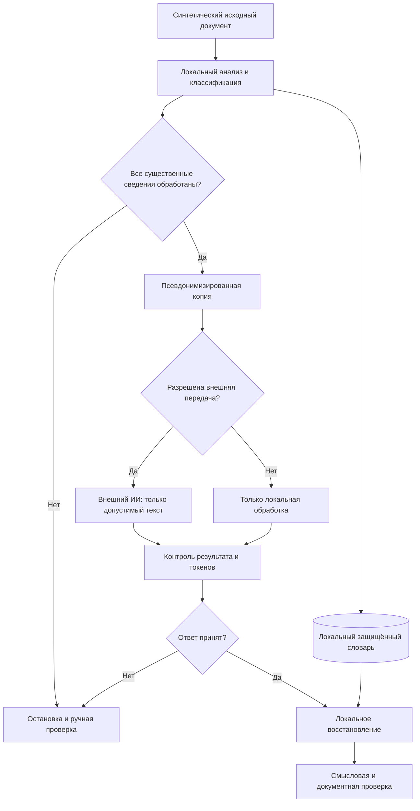

*Сквозной учебный пример обратимой псевдонимизации, обработки текста и контроля результата*

**Статус примера:** УЧЕБНАЯ ИМИТАЦИЯ. ВЫМЫШЛЕННЫЕ ДАННЫЕ. НЕ ЯВЛЯЕТСЯ СЕКРЕТНЫМ ДОКУМЕНТОМ.

## Аннотация

При работе с техническим заданием, договором, программой и методикой испытаний или эксплуатационной документацией возникает практическая задача: использовать возможности искусственного интеллекта для редакционной и аналитической обработки текста, не раскрывая организации, участников, изделия и другие защищаемые сведения. Простая замена названий на «XXX» не решает эту задачу. Необходимо сохранить связи между документами, предусмотреть обратное восстановление обозначений и оценить, какие сведения продолжают раскрываться через содержание, структуру и метаданные.

В статье приведён **полностью синтетический** сквозной пример: подготовка нескольких связанных документов, локальная замена идентификаторов, формирование безопасного для выбранной модели обработки текста, пример результата ИИ, восстановление исходных обозначений и контроль ошибок. Демонстрируется **проектная логика** локального анонимизатора, а не результаты испытаний конкретной программы: исходный код и протоколы запуска реального приложения для данной публикации не предоставлены.

Основной вывод: **обратимая замена имён является псевдонимизацией, а не гарантированным устранением конфиденциальности документа**. Передача даже такого текста во внешний сервис допустима только после оценки содержания и при наличии правового и организационного основания.

## 1. Задача и ограничения

В обычной практике техническому писателю требуется проверить однозначность требований, построить матрицу трассировки, нормализовать терминологию и обнаружить противоречия между ТЗ и ПМИ. Искусственный интеллект может существенно ускорить эту работу, но исходный документ часто содержит сведения, которые не должны попадать за пределы контролируемой среды.

Следует различать три действия:

| Действие | Суть | Возможно ли восстановление | Что означает для безопасности |
|---|---|---|---|
| Маскирование | Замена выбранного фрагмента на условное обозначение | Зависит от механизма | Другие идентификаторы и контекст могут сохраняться |
| Псевдонимизация | Замена сущностей устойчивыми токенами, при которой отдельная дополнительная информация позволяет восстановить соответствие | Да, при наличии защищённого словаря | Сохраняются связи и часть риска повторной идентификации |
| Анонимизация в строгом смысле | Преобразование, после которого повторная идентификация практически исключена в установленной модели угроз | Не предполагается | Требует самостоятельной оценки остаточного риска, а не только замены имён |
| Редактирование с удалением | Исключение выбранных сведений или их обобщение | Как правило, нет | Уменьшает информативность; может ухудшить работу ИИ |
| Рассекречивание | Юридически установленная процедура изменения режима охраны сведений | Не относится к подстановке токенов | **Никакой скрипт замены сам по себе не снимает режим секретности** |

Термин «псевдонимизация» в статье применяется как техническое описание обратимого преобразования, в том числе к сведениям об организациях и изделиях; определение применительно к персональным данным приведено в п. 5 ст. 4 GDPR [2]. Подход к оценке остаточного риска соответствует общим принципам NIST SP 800-188 [1].

**Юридическое ограничение.** Для документов, содержащих сведения, составляющие государственную тайну, использование внешнего ИИ нельзя обосновывать одним фактом замены названий. Режим доступа и порядок рассекречивания регулируются законодательством о государственной тайне [3]. Аналогично оцениваются ограничения по коммерческой тайне, персональным данным и договорным обязательствам. В данной публикации исходники заведомо вымышленные и не содержат сведений ограниченного доступа.

## 2. Демонстрационный проект: единый сюжет для связанных документов

Используются вымышленные организации и изделие:

- **Заказчик:** НПО «Кромешные секреты».
- **Исполнитель:** ПО «Абсолютно секретно».
- **Изделие:** учебная система «Лабиринт-7», регистрирующая состояние макета климатической установки.
- **Договор:** № КС-АС/26-017 от 15.06.2026.
- **Предмет работ:** поставка демонстрационного программного комплекса и проведение приёмочных испытаний.
- **Объём:** 12 учебных каналов измерений.
- **Срок завершения:** 30.09.2026.
- **Стоимость:** 4 800 000 условных рублей; суммы не связаны ни с какой реальной сделкой.
- **Условный ответственный за испытания:** Ирина Полынцева, персонаж учебного досье.

Параметры специально подобраны так, чтобы показать как прямые, так и косвенные утечки. В реальном проекте даже сочетание срока, количества каналов, стоимости и назначения может иметь охраняемый характер.

### 2.1. Фрагмент договора

> **УЧЕБНАЯ ИМИТАЦИЯ.** НПО «Кромешные секреты» поручает ПО «Абсолютно секретно» поставку системы «Лабиринт-7» в составе 12 каналов измерений в соответствии с ТЗ-01. Стоимость работ по договору № КС-АС/26-017 составляет 4 800 000 условных рублей. Передача результата и завершение испытаний выполняются не позднее 30.09.2026.

Для демонстрации достаточно этого фрагмента. Он содержит названия сторон, обозначение изделия, реквизит договора, количество, срок и сумму. Замена только наименований организаций оставит существенные сведения о проекте в открытом виде.

### 2.2. Фрагмент технического задания

> **ТЗ-01, требование R-01.** Система «Лабиринт-7» должна принимать сообщения от 12 учебных каналов измерений и регистрировать результаты в журнале событий.
>
> **ТЗ-01, требование R-02.** Время отображения принятого сообщения в интерфейсе оператора не должно превышать 250 мс в условиях испытаний, определённых ПМИ-01.
>
> **ТЗ-01, требование R-03.** При разрыве соединения должна выполняться локальная буферизация событий с последующей синхронизацией.

Здесь появляются технические параметры и информация об архитектуре. Следовательно, правило «заменить только имена собственные» недостаточно.

### 2.3. Фрагмент программы и методики испытаний

> **ПМИ-01, испытание T-01, проверка R-01.** Подать на 12 входных каналов последовательность учебных сигналов. Проверить наличие записи для каждого канала.
>
> **ПМИ-01, испытание T-02, проверка R-02.** Сформировать 100 тестовых событий; подтвердить, что время отображения каждого события не превышает 250 мс.
>
> **ПМИ-01, испытание T-03, проверка R-03.** Прервать соединение на 60 с и подтвердить сохранность сообщений после возобновления обмена.

### 2.4. Сопутствующие документы

| Документ | Учебное содержание | Особенность обезличивания |
|---|---|---|
| Протокол ПР-01 | Результаты T-01—T-03, номера дефектов | Не оставлять реальные диагностические строки или внутренние пути |
| Спецификация СП-01 | 12 каналов, модуль сбора, сервер, АРМ | Комбинация компонентов может указывать на назначение |
| Акт АК-01 | Стороны, основание, дата приёмки | Сохранять юридическую роль сторон, не реальные реквизиты |
| Служебная записка СЗ-01 | Замечания к требованиям R-02, R-03 | В тексте могут сохраняться сведения о недостатках |
| Письмо ПС-01 | Адресат, отправитель, название изделия | Контролировать подписи, вложения и цепочку ответов |
| Ведомость ВД-01 | Комплект и номера редакций | Выявлять избыточную детализацию состава поставки |

Формальные обозначения здесь учебные; приведённые фрагменты не объявляются комплектом документов, прошедшим нормоконтроль по конкретному ГОСТ. Для рабочего комплекта применимая система стандартов и полнота обязательных разделов устанавливаются отдельно.

## 3. Как определяется состав подлежащих защите данных

Детектор должен анализировать не только фамилии и названия, но и **классы содержания**. Предварительное решение об обработке принимается на основании политики допуска.

| Класс | Пример | Предлагаемый режим | Причина |
|---|---|---|---|
| Организация | НПО «Кромешные секреты» | Устойчивый токен в рамках согласованного комплекта | Сохраняются договорные роли |
| Изделие | «Лабиринт-7» | Устойчивый токен | Сохраняются ссылки ТЗ—ПМИ |
| Физическое лицо | Ирина Полынцева | Токен или удаление | Личность не нужна для языковой правки |
| Номер договора | КС-АС/26-017 | Токен | Исключается прямое сопоставление с внешними записями |
| Дата | 30.09.2026 | Токен либо обобщение «конец квартала» | Дата может быть уникальным признаком |
| Сумма | 4 800 000 | Токен или диапазон | Стоимость раскрывает масштаб |
| Количество | 12 каналов | Токен либо «несколько каналов» | Количество характеризует конструкцию |
| Порог | 250 мс | Токен или допустимый условный параметр | Число может раскрыть свойства системы |
| Архитектура | Локальная буферизация | Редактирование по политике | Даже без имён раскрывается функциональная особенность |
| Трассировка | R-02 ↔ T-02 | Сохранить или переобозначить единым образом | Требуется для контроля испытаний |

**Важно:** сохранение точных чисел, дат, топологии или необычных сочетаний разрешается только при наличии отдельного решения об их допустимости. Замена одного имени не делает оставшийся абзац безопасным для внешнего сервиса.

## 4. Внутренняя таблица соответствий

При обратимой обработке создаётся словарь «исходное значение — токен». Он должен храниться **локально** и быть отделён от текста, передаваемого на внешнюю обработку.

**Таблица 1 — Пример соответствий (только вымышленные данные)**

| Исходное значение | Класс | Токен | Правило | Обратимо |
|---|---|---|---|---|
| НПО «Кромешные секреты» | Организация | `[ОРГ_001]` | Стабильность в рамках учебного досье | Да |
| ПО «Абсолютно секретно» | Организация | `[ОРГ_002]` | Стабильность в рамках учебного досье | Да |
| «Лабиринт-7» | Изделие | `[ИЗДЕЛИЕ_001]` | Сохранять ссылки между файлами | Да |
| КС-АС/26-017 | Договор | `[ДОГОВОР_001]` | Не подменять номера других договоров | Да |
| Ирина Полынцева | Лицо | `[ЛИЦО_001]` | Обрабатывать падежные формы | Да |
| 30.09.2026 | Дата | `[ДАТА_001]` | Не оставлять дату в имени файла | Да |
| 4 800 000 условных рублей | Сумма | `[СУММА_001]` | Обрабатывать варианты записи числа | Да |
| 12 учебных каналов | Количество | `[КОЛ_001]` | Согласовывать склонение в предложении | Да |
| 250 мс | Параметр | `[ПАРАМЕТР_001]` | Не раскрывать порог через другие таблицы | Да |
| Сведения о конкретной топологии | Содержание | `[ФРАГМЕНТ_УДАЛЕН]` | Необратимое редакционное удаление | Нет |

В промышленном варианте у каждой записи целесообразно предусмотреть идентификатор набора, версию словаря, тип сущности, диапазон применения и контроль согласованности. Токен не должен содержать реальное имя, узнаваемый фрагмент обозначения, контрольную сумму исходной строки, позволяющую выполнять простое словарное угадывание, или иные подсказки. При передаче разных материалов во внешний сервис необходимо отдельно оценивать риск корреляции, создаваемый устойчивыми токенами.

**Техническое требование:** словарь соответствий, криптографические ключи и исходные защищаемые файлы не передаются модели и не включаются в системный запрос. Для реального решения необходимы шифрование словаря в состоянии хранения, управление ключами, ограничение доступа, контроль резервных копий и безопасная обработка сбоев. Наличие этих функций в конкретном приложении требует подтверждения испытаниями.

## 5. Полный цикл «оригинал — замена — ИИ — восстановление»

Рассматриваются **две разные архитектуры**.

1. **Полностью локальная обработка:** исходный документ, обнаружение сущностей, словарь и локальная языковая модель находятся в установленной доверенной среде. Отсутствие внешнего ИИ не освобождает от проверки телеметрии, сторонних служб и журналов.
2. **Обработка с внешним ИИ:** исходный документ и словарь остаются локально; за границу доверия передаётся только специально подготовленный **разрешённый** фрагмент. Передача прекращается, если правила допуска не выполнены.

**Рисунок 1 — Условная последовательность обработки**

Схема отражает желаемое поведение разрабатываемого решения; существование перечисленных механизмов в конкретном скрипте не подтверждалось. Исходные данные, ключи и локальный словарь не должны пересекать границу доверия внешнего сервиса.

### 5.1. Четыре состояния одного фрагмента

**Таблица 2 — Основная сравнительная таблица**

| Этап | Текст |
|---|---|
| 1. Исходный учебный текст | «Система „Лабиринт-7“ должна принимать сообщения от 12 учебных каналов измерений. Испытание выполняет Ирина Полынцева». |
| 2. После локальной замены | «Система `[ИЗДЕЛИЕ_001]` должна принимать сообщения от `[КОЛ_001]`. Испытание выполняет `[ЛИЦО_001]`». |
| 3. Иллюстративный результат ИИ | «Система `[ИЗДЕЛИЕ_001]` должна обеспечивать приём сообщений от `[КОЛ_001]`. Проверку выполнения требования проводит `[ЛИЦО_001]`». |
| 4. После локального восстановления | «Система „Лабиринт-7“ должна обеспечивать приём сообщений от 12 учебных каналов измерений. Проверку выполнения требования проводит Ирина Полынцева». |

В третьей строке приведён **вручную подготовленный иллюстративный вариант ответа**, а не зарегистрированный ответ внешнего ИИ. Цель таблицы — пояснить принцип восстановления.

Отдельного контроля требует изменение глагола «принимать» на «обеспечивать приём»: оно может быть редакционно допустимым, но решение должно приниматься с учётом спецификации требования. Автоматическое восстановление токенов не доказывает смысловую корректность переработанного текста.

### 5.2. Пример учебного запроса

> Выполнить редакционную проверку требования R-01. Сохранить токены `[ИЗДЕЛИЕ_001]` и `[КОЛ_001]` **без изменений**, не добавлять новые токены, не угадывать исходные наименования. Предложить одну формулировку требования и отдельно перечислить неоднозначности. Исходный фрагмент: «Система `[ИЗДЕЛИЕ_001]` должна принимать сообщения от `[КОЛ_001]`».

Рекомендуемая структура ответа: исправленный текст, пояснение правок, перечень обнаруженных неоднозначностей и признак отсутствия исходных данных для количественной проверки. Даже при таком запросе ответ нельзя принимать без локальной валидации: языковая модель может изменить, пропустить или выдумать маркер.

### 5.3. Проверка целостности

Перед восстановлением необходимо проверить:

- каждый обнаруженный маркер принадлежит текущему набору и имеет запись в словаре;
- написание маркеров соответствует точному формату, например `[ИЗДЕЛИЕ_001]`, а не `[ИЗДЕЛИЕ-001]`;
- отсутствуют новые неожиданные обозначения и фрагменты исходных конфиденциальных данных;
- сохранена допустимая связь R-01—T-01, R-02—T-02, R-03—T-03;
- даты, единицы измерения, роли сторон и ссылки не изменены без согласованного основания;
- в выходных файлах отсутствуют необработанные метаданные, комментарии, встроенные объекты и другие скрытые носители информации.

**Политика отказа:** неизвестный токен, повреждение словаря, расхождение идентификаторов или неподтверждённое содержание приводят к отказу от автоматического выпуска, а не к «приблизительному восстановлению по догадке».

## 6. Почему нельзя ограничиться заменой текста в абзацах

Документ — не только последовательность видимых символов. При работе с DOCX, PDF, TXT и MD необходимо отдельно контролировать следующие области.

**Таблица 3 — Области проверки форматов**

| Формат | Что проверять | Типовая опасность |
|---|---|---|
| DOCX | Основной текст, таблицы, колонтитулы, сноски, комментарии, отслеживаемые изменения, поля, свойства, скрытый текст, встроенные объекты | Видимый текст изменён, но исходное значение осталось в XML-пакете, комментарии или изображении |
| PDF | Текстовый слой, изображения, аннотации, вложения, закладки, свойства файла, скрытые слои | Внешне закрытый участок текста продолжает извлекаться программно; скан не обработан |
| TXT | Кодировка, управляющие символы, переносы, содержимое и имя файла | Появляются пропуски из-за разных вариантов написания |
| MD | Текст, YAML-шапка, комментарии, изображения, ссылки, адреса, фрагменты кода, имена вложений | Наименование или адрес остался в URL, пути или блоке метаданных |

Использование OCR допускается только после определения состава сканов и анализа его точности. Если в изображении может находиться защищаемый текст, а средство не гарантирует его выявление, передача такого файла блокируется до ручной проверки.

## 7. Какие проверки подтверждают работу приложения

Достоверный рассказ о реальном скрипте должен включать протокол испытаний. Для рассматриваемого проекта такие протоколы **не предоставлены**, поэтому значения производительности, точности обнаружения, отсутствия сетевых обращений или корректности поддержки форматов не приводятся.

**Таблица 4 — Обязательная программа испытаний (план; не результаты)**

| Идентификатор | Испытание | Ожидаемый критерий | Статус |
|---|---|---|---|
| AT-01 | Повторяющиеся названия в договоре, ТЗ и ПМИ | Один токен в заданной области обработки | Не проводилось |
| AT-02 | Склонения и сокращения | Нет пропущенных форм без регистрации исключений | Не проводилось |
| AT-03 | Похожие обозначения | Отсутствуют коллизии и неверные подстановки | Не проводилось |
| AT-04 | DOCX со сноской и комментариями | Защищаемые сведения удалены из всех проверяемых частей | Не проводилось |
| AT-05 | PDF со сканированным листом | Файл отклонён либо изображение надёжно обработано | Не проводилось |
| AT-06 | MD с YAML и ссылками | Прямые идентификаторы отсутствуют в метаданных и адресах | Не проводилось |
| AT-07 | Неизвестный или испорченный токен | Восстановление блокируется с диагностикой | Не проводилось |
| AT-08 | Отсутствие ключа, сбой шифрования | Безопасный отказ без выпуска некорректного файла | Не проводилось |
| AT-09 | Разрыв процесса, повторный запуск | Нет частично выпущенных файлов; состояние согласовано | Не проводилось |
| AT-10 | Локальный режим без сети | При наблюдении не выявлено запрещённых сетевых передач | Не проводилось |
| AT-11 | Журналы, кэш, резервные копии | Исходные значения не появляются вне разрешённых хранилищ | Не проводилось |
| AT-12 | Изменение ИИ идентификатора R-02 | Результат отклонён или отправлен на ручное согласование | Не проводилось |
| AT-13 | Число скрыто, но раскрыто формулой | Не проходит контроль косвенного раскрытия | Не проводилось |
| AT-14 | Обратное восстановление | Все восстанавливаемые значения совпадают с эталоном | Не проводилось |

Измеряемые показатели: полнота обнаружения, доля ложных обнаружений, доля пропусков по типам носителей, целостность токенов, сохранность трассировки, число ручных исправлений, количество нарушений политики допуска и время работы. До проведения испытаний не следует заявлять «100 % точности» либо «гарантированное отсутствие утечек».

Для режима без сети отдельно проверяются соединения приложения и зависимостей, активные сетевые интерфейсы, телеметрия операционной системы и сторонние плагины. Отсутствие сетевого пакета в ограниченном эксперименте подтверждает только **границы данного эксперимента**, а не математическую невозможность передачи при иных условиях.

## 8. Остаточные риски, которые сохраняются после замены

Оставленный документ может продолжать сообщать постороннему наблюдателю о классе системы, количестве каналов, графике испытаний, функциональных ограничениях и отношениях между сторонами. Устойчивые токены сохраняют граф связей между материалами. Наконец, свойства документа, имена файлов и история запросов способны раскрыть дополнительный контекст.

Для снижения риска следует применять минимизацию содержимого по задаче: для редакционной проверки грамматики не требуется отправлять стоимость, состав поставки или сведения об архитектуре. Для построения матрицы трассировки может потребоваться сохранять идентификаторы R-01 и T-01, но не реальные наименования изделий. Если нужный результат достижим только посредством раскрытия защищаемых признаков, внешняя обработка исключается.

Подробная систематизация этих рисков приведена в связанной публикации [«Как ИИ восстанавливает секретные сведения из анонимизированных документов: косвенные признаки»](/alsibir-expert/blog/security/02_residual_disclosure_risks/).

## 9. Практический сценарий демонстрации заказчику

1. **Подготовить комплект:** договор, ТЗ, ПМИ, протокол, акт, спецификацию и дополнительные учебные файлы. Каждый пометить как синтетический.
2. **Зафиксировать конфигурацию:** ОС, версию приложения, перечень зависимостей, режим сети, контрольные суммы файлов и политику допустимых классов данных.
3. **Выполнить предварительное обнаружение:** показать список объектов и принять решения по неопределённым находкам. Не переписывать исходники.
4. **Создать копию и словарь:** сформировать токены и локальную таблицу соответствий с контролем повторяемости сущностей.
5. **Проверить полноту:** просмотреть текст, метаданные, скрытые объекты, таблицы, вложения и имена файлов. Выявленные неопределённости устранить до передачи.
6. **Проверить допустимость:** определить, разрешён ли выбранный обезличенный фрагмент для внешней обработки. При отказе использовать согласованную локальную модель либо ручную работу.
7. **Показать запрос и ответ:** на исключительно учебном содержании продемонстрировать правку требования или построение матрицы R—T.
8. **Проверить токены:** обнаружить удаления, изменения, чужие маркеры, вымышленные требования и смысловые искажения.
9. **Выполнить локальное восстановление:** подставить исходные значения только по защищённому словарю.
10. **Провести финальную проверку:** сравнить исходные и итоговые документы; отдельно зафиксировать сделанные ИИ редакционные изменения.

**Критерий успешного показа:** заказчик получает не утверждение об «абсолютной безопасности», а проверяемую цепочку файлов, протоколов контроля, выявленных ограничений и обоснований допустимости. Если реальные результаты проверки скрипта отсутствуют, демонстрация должна называться концептуальной.

## 10. Принципы проектирования локального интеллектуального анонимизатора

Продукт, предназначенный для обработки технических документов, целесообразно строить из независимых компонентов: извлечение данных и инвентаризация содержимого; выявление именованных и предметных сущностей; правила классификации; контекстно-зависимое преобразование; защищённое хранение соответствий; контроль остаточных сведений; шлюз допуска; валидация ответа; обратное восстановление; аудит действий. Для каждого компонента требуется своя спецификация и набор испытаний.

Интеллектуальный классификатор может помогать выявлять нестандартные обозначения, вложенные наименования и смысловые признаки. Однако его решение не следует считать окончательным для документов с высокой ценой утечки. Предварительный просмотр, ручное подтверждение сомнительных случаев и политика запрета на выпуск при ошибке необходимы независимо от выбранного алгоритма.

Возможность запуска через контекстное меню файлового менеджера повышает удобство, но не заменяет функции защиты. В частности, интерфейс не должен автоматически отправлять файлы в облако, записывать исходный текст в диагностические журналы либо хранить ключ дешифрования в одном открытом каталоге со словарём.

## 11. Вывод

Безопасная редакционная работа с ИИ начинается не с подстановки маркеров, а с установления границы доверия и допустимого содержания запроса. Обратимая псевдонимизация удобна: она сохраняет обозначения объектов и помогает переносить результат обработки обратно в технический документ. Но она не отменяет требований по защите исходной информации и не устраняет косвенное раскрытие через числовые, временные, структурные и технические особенности.

**Профессионально обоснованное решение** должно показывать четыре состояния текста, защищённый механизм соответствий, правила допуска, автоматические проверки, обработку ошибок и фактические протоколы испытаний. Пока испытания конкретного анонимизатора не выполнены, допустимо демонстрировать только проектную схему и учебные данные, не приписывая скрипту неподтверждённые свойства.

## Использованные источники

1. NIST SP 800-188. *De-Identifying Government Datasets: Techniques and Governance*. 2023. <https://csrc.nist.gov/pubs/sp/800/188/final>.
2. Regulation (EU) 2016/679 (GDPR), Article 4(5): definition of pseudonymisation. <https://eur-lex.europa.eu/legal-content/EN/TXT/?uri=CELEX%3A32016R0679>.
3. Закон РФ от 21.07.1993 № 5485-1 «О государственной тайне», в частности положения о порядке рассекречивания. <https://www.consultant.ru/document/cons_doc_LAW_2481/>.
4. OWASP. *LLM02:2025 Sensitive Information Disclosure*. <https://owasp.github.io/www-project-top-10-for-large-language-model-applications/2_0_vulns/LLM02_SensitiveInformationDisclosure.html>.

*Дата подготовки редакции — 09.10.2026. Ссылки на источники требуют обычной заключительной проверки перед размещением на публичном сайте.*
