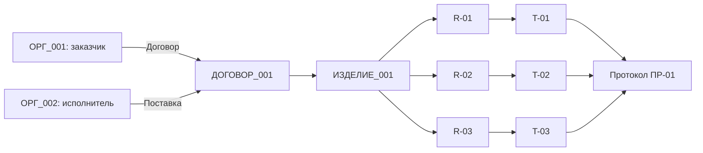

*Модель угроз, квази-идентификаторы, междокументные связи и границы достоверности выводов*

**Статус примера:** УЧЕБНАЯ ИМИТАЦИЯ. ВЫМЫШЛЕННЫЕ ДАННЫЕ. НЕ ЯВЛЯЕТСЯ СЕКРЕТНЫМ ДОКУМЕНТОМ.

## Аннотация

Документ может не содержать ни одного подлинного имени, но раскрывать назначение изделия, стадию разработки, особенности технологического процесса, характер взаимоотношений между организациями и компетенции участников. Достаточно сохранить сроки, технические параметры, взаимные ссылки, структуру документа и историю изменений — и отдельные фрагменты начинают складываться в информативную картину.

В статье приведена модель **остаточного раскрытия информации** после анонимизации или псевдонимизации документов. Рассматриваются прямые остатки идентификаторов, метаданные, стилометрия, числа, даты, география, технические особенности, граф связей, сопоставление с внешними источниками и накопительный эффект серии запросов к ИИ. Все примеры построены **исключительно на вымышленных документах и вымышленных «публичных источниках»**. Не предпринимается попыток установить реальных лиц, организации или защищаемые государством сведения.

**Главный тезис:** языковая модель не обязана знать исходные наименования, чтобы извлекать из обезличенного корпуса аналитически значимые сведения. При этом правдоподобная догадка модели не является доказанной идентификацией.

## 1. Что означает «восстановить сведения»

В техническом анализе нужно разграничить четыре существенно разных результата:

1. **Восстановление прямого остатка:** в переданном материале сохранился идентификатор — например, доменное имя в ссылке, имя автора в свойствах файла или название сервера в журнале.
2. **Вывод из содержания:** текст прямо указывает, что система рассчитана на несколько измерительных каналов, имеет локальную буферизацию и проходит испытания. Название системы не требуется.
3. **Корреляция:** совокупность признаков сопоставляется с дополнительным набором сведений, после чего некоторые версии становятся более согласованными с наблюдениями.
4. **Предположение модели:** ИИ выдаёт конкретное название организации, имя специалиста или назначение изделия без достаточно проверяемых оснований. Такой ответ может быть выдуманным.

Только первый случай при наличии достоверного исходного фрагмента и часть второго относятся к непосредственно подтверждаемым сведениям. Третий зависит от полноты вспомогательной информации и качества сопоставления. Четвёртый не должен представляться как успех деанонимизации.

Принципы учёта квази-идентификаторов, целей распространения данных и самостоятельной оценки риска рассматриваются в NIST SP 800-188 [1]. Обратимая псевдонимизация не тождественна анонимизации; стабильный токен сохраняет возможность связывать записи между собой [2].

### 1.1. Шкала доказательности

| Уровень | Обозначение | Пример корректного вывода | Что запрещено утверждать |
|---|---|---|---|
| Наблюдение | Н | «В ПМИ указаны испытания T-01 и T-02» | «Известен заказчик» |
| Логическое следствие | С | «T-02 проверяет R-02, следовательно, присутствует связка требование—испытание» | «Известна фактическая реализация системы» |
| Условный вывод | У | «Если документ актуален и испытания завершены, проект мог перейти к приёмке» | «Приёмка точно состоялась» |
| Гипотеза | Г | «Система, вероятно, относится к мониторингу промышленного оборудования» | «Это конкретное реальное изделие» |
| Не проверяется | НП | «По тексту невозможно установить, кто именно написал документ» | Любое точное ФИО без достаточного источника |

Каждый аналитический вывод должен сопровождаться указанием фрагмента-основания, предпосылок, альтернативных интерпретаций и необходимых данных для проверки.

## 2. Кто именно может получить информацию

Понятия «ИИ», «провайдер» и «сторонний наблюдатель» не следует смешивать.

| Субъект | Потенциально доступные сведения | Ограничение утверждения |
|---|---|---|
| Языковая модель в пределах отдельного вызова | Текст запроса, переданные вложения и полученный в этом вызове контекст | Не предполагается автоматический доступ к другим беседам или внутренним данным сервиса |
| Приложение, вызывающее модель | Ввод пользователя, подготовленные файлы, журналы своей обработки | Реальные настройки зависят от архитектуры приложения |
| Оператор внешнего сервиса | Содержимое и метаданные, доступные ему в рамках фактических систем обработки и правил хранения | Конкретный объём зависит от сервиса, настроек, договора и применимого права |
| Администратор корпоративной среды | Допустимые ему журналы доступа, шлюзы, средства контроля и метаданные | Полномочия определяются регламентами |
| Внешний аналитик | Переданные ему документы, собственные базы, открытые и другие законно полученные сведения | Не следует автоматически приписывать наличие секретных баз или полных журналов провайдера |

Иными словами, формулировка «ИИ запомнил все секреты» технически некорректна без определения платформы и режима обработки. Вместе с тем факт передачи содержимого и возможность его сохранения или последующего использования должны оцениваться **до отправки**, а не после неё. Категория риска раскрытия конфиденциальных сведений в приложениях с большими языковыми моделями выделена в OWASP LLM02:2025 [3].

## 3. Учебное досье: что удалено и что осталось

Рассматривается тот же полностью вымышленный проект, что и в статье [«Как выглядит анонимизация секретных документов: от оригинала к ИИ и обратно»](/alsibir-expert/blog/security/01_anonymization_cycle/): заказчик НПО «Кромешные секреты», исполнитель ПО «Абсолютно секретно», учебная система «Лабиринт-7».

В переданном **учебном псевдонимизированном комплекте** могут оставаться следующие фразы:

> «По договору `[ДОГОВОР_001]` исполнитель `[ОРГ_002]` должен передать заказчику `[ОРГ_001]` систему `[ИЗДЕЛИЕ_001]` до `[ДАТА_001]`».
>
> «R-01. Система `[ИЗДЕЛИЕ_001]` должна принимать сообщения от 12 учебных каналов измерений».
>
> «R-02. Время отображения события не должно превышать 250 мс».
>
> «T-02. Выполнить 100 измерений времени отображения и подтвердить соответствие R-02».
>
> «T-03. После прерывания связи на 60 с подтвердить сохранность и синхронизацию сообщений».

Для второй статьи сознательно рассмотрен **слабый режим обработки**, в котором названия и договорный реквизит заменены, а числовые и технические параметры оставлены. Этот текст предназначен только для проверки рисков на вымышленных данных; для реального защищаемого проекта такой режим может быть недопустим.

Из приведённого набора **без знания истинного названия** уже следует, что существуют две договорные стороны, функциональный компонент обработки событий, требование к задержке интерфейса, устойчивость к кратковременному разрыву связи и механизм приёмочных испытаний. Это выводы о содержании, а не успешное раскрытие личности заказчика.

## 4. Полный каталог косвенных признаков

В таблице охвачены основные категории, которые следует проверять при подготовке документа к внешнему ИИ. Категории перекрываются: один объект способен содержать сразу несколько видов сведений.

**Таблица 1 — Признаки и последствия остаточного раскрытия**

| № | Категория | Пример сохраняющегося признака | Возможный вывод | Способ уменьшения риска |
|---|---|---|---|---|
| 1 | Прямые остатки | ФИО в подписи, домен, реквизит, e-mail | Прямая привязка документа | Проверка всех мест хранения и удаление |
| 2 | Метаданные DOCX | Автор, последний редактор, шаблон, комментарии | Участники подготовки, среда и организация | Очистка свойств, правок и скрытых частей |
| 3 | Метаданные PDF | Производитель, заголовок, аннотации, вложения | Средство создания, связь с источником | Проверка текстового слоя, свойств и вложений |
| 4 | Имена и структура файлов | `ПМИ_Лабиринт7_финал.docx`, путь к проекту | Название и стадия проекта | Нейтральные имена и отдельная проверка каталога |
| 5 | Технические идентификаторы | Номер сборки, трассы, задачи, коммита | Связь с другими артефактами | Регенерация или токенизация идентификаторов |
| 6 | Стабильные токены | `[ОРГ_001]` повторяется в 20 запросах | Корпус относится к одному субъекту | Ограничить область стабильности токенов |
| 7 | Стилометрия | Редкие обороты, синтаксис, опечатки | Сходство текстов или общий авторский стиль | Редакционная нормализация при допустимости |
| 8 | Профессиональный словарь | ГОСТ, ПМИ, API, SQL, протоколы испытаний | Возможная специализация участника | Минимизировать несвязанные с задачей фрагменты |
| 9 | Корпоративные шаблоны | Уникальная форма согласования | Принадлежность к общей документной практике | Нормализовать шаблон до типового представления |
| 10 | Структура ТЗ и ПМИ | R-01—T-01, подписи, последовательность разделов | Стадия и организация жизненного цикла | Передавать только нужную часть трассировки |
| 11 | Состав изделия | Количество модулей, интерфейсов | Класс и масштаб технической системы | Обобщать параметры или исключать раздел |
| 12 | Программный стек | ОС, СУБД, брокер, язык, версии | Архитектурные зависимости и технологический профиль | Убирать ненужные имена и версии |
| 13 | Сетевая архитектура | Клиент, шлюз, очередь, направление потоков | Логика взаимодействия и границы доверия | Обобщать роли или исключать топологию |
| 14 | Журналы и ошибки | Коды событий, последовательности сбоев | Профиль эксплуатации и проблемные функции | Исключать строки, версии, адреса, внутренние коды |
| 15 | Защитные механизмы | Тип авторизации, порядок обновления, резервирование | Предполагаемые защитные границы | Передавать лишь сведения, необходимые для задания |
| 16 | Даты и последовательности | Дата договора, релиза, ПМИ | График разработки, этап работ | Обобщать время, сохранять только требуемый порядок |
| 17 | Деньги и объёмы | Стоимость, число устройств, этапные платежи | Масштаб и организационные приоритеты | Обобщать или заменять и проверять расчётные связи |
| 18 | География | Часовой пояс, климат, нормативная среда | Возможный район эксплуатации | Убирать несвязанные маркеры |
| 19 | Ограничения и исключения | «Функция X в версии 1.0 отсутствует» | Ограничения продукта или этап внедрения | Избегать несущественных отрицательных требований |
| 20 | Таблицы, изображения, схемы | Подписи, топология, цветовая маркировка | Состав, отношения и скрытые идентификаторы | Анализировать нетекстовые носители |
| 21 | Арифметические зависимости | Сумма частей, процент от бюджета | Скрытое число можно вычислить | Контролировать взаимосвязанные величины |
| 22 | Граф согласований | Кто утверждает, проверяет, исправляет | Организационная иерархия и влияние ролей | Псевдонимизировать роли либо удалить цепочку |
| 23 | Перекрёстные ссылки | Версии ТЗ, номера дефектов, протоколы | Изменения статуса проекта | Разрывать ненужные связи |
| 24 | История запросов | Серии промптов об одном изделии | Изменение функциональности и сроков | Ограничивать накопление, разъединять сессии |
| 25 | Дополнительные сведения | Сопоставимые фиктивные новости и вакансии | Сужение множества гипотез | Учитывать внешнюю связуемость |

**Вывод из таблицы:** полезная для ИИ структура документа почти всегда одновременно является потенциальным источником аналитических признаков. Полное подавление связей может сделать задачу невозможной; поэтому необходимо не абстрактное «удаление всего», а согласованная политика минимизации.

## 5. Что можно предположить об авторе

Языковой анализ может обнаружить терминологию, характерную для технического писателя, системного аналитика, инженера по испытаниям или специалиста по информационной безопасности. Например, последовательные связи R-01—T-01, формализованные критерии приёмки и нумерация разделов свидетельствуют о знакомстве автора либо разработчика шаблона с практикой ведения технической документации.

При этом следует учитывать альтернативы:

- документ мог быть подготовлен несколькими людьми;
- его стиль мог быть сформирован корпоративным шаблоном;
- часть текста могла быть переработана генеративной моделью;
- термины могли быть заимствованы из нормативного документа или чужого примера;
- автор мог только редактировать чужой материал.

**Допустимый вывод:** «Текст оформлен с использованием терминологии ТЗ и ПМИ, содержит трассировку требований и испытаний» (наблюдение). **Осторожная гипотеза:** «К подготовке вероятно привлекался специалист, знакомый с техническим документированием» (гипотеза). **Недопустимый вывод:** конкретное ФИО, место работы, психологические особенности, здоровье или личные убеждения автора без надёжных независимых доказательств.

Стилометрическая похожесть двух текстов не доказывает единоличное авторство, особенно при сильной стандартизации и использовании шаблонов.

## 6. Что можно узнать об организациях и отношениях сторон

Из договора, ТЗ и ПМИ легко построить абстрактную схему отношений. Для неё не нужны реальные фирменные наименования.

**Рисунок 1 — Граф связей учебного комплекта**

Из структуры непосредственно видны роли заказчика и исполнителя, наличие приёмочного контроля и прослеживаемость от требования к испытанию. Если добавить акты согласования и протоколы отклонений, можно увидеть маршруты принятия решений и зависимость результата от согласований. Однако организационная структура конкретных компаний и личности руководителей из такой схемы **не устанавливаются**.

Стабильные псевдонимы облегчают качественный анализ: ИИ понимает, что `[ОРГ_001]` в договоре и `[ОРГ_001]` в акте — одна сторона. Та же особенность создаёт риск накопления профиля. Замена токенов на новые в каждом документе уменьшает корреляцию, но способна разрушить полезную трассировку. Компромисс выбирается по требуемой задаче.

## 7. Что можно узнать о проекте и его стадии

Из R-01—R-03 и T-01—T-03 наблюдатель может установить, что документированная система обрабатывает события, предъявляет требования к скорости отображения и должна сохранять сообщения при временном разрыве связи. Наличие ПМИ указывает на **подготовку к испытаниям** или их проведение, но само по себе не доказывает завершение разработки либо приемку.

Ограничения раскрывают информацию не хуже позитивных требований. Фраза «в версии 1.0 резервный канал не поддерживается» означает отсутствие такой функции в описываемом варианте продукта; при этом нельзя автоматически заключить, что она отсутствует в других версиях или в смежном оборудовании.

Точные детали стека и топологии способны существенно увеличить информативность документа: например, сведения о сервере, брокере сообщений, контроллерах, версиях операционных систем, протоколах, диапазонах задержки и частоте обновления. Для внешней языковой правки такие детали обычно не нужны. При анализе архитектуры их обработку следует выполнять в доверенной среде либо применять утверждённую модель передачи.

## 8. Числовые, временные и логические утечки

Особенность количественных сведений — их возможность **восстановить расчётом**, даже когда исходное значение заменено токеном.

### 8.1. Пример восстановления суммы

Предположим, в учебном договоре общая стоимость заменена на `[СУММА_001]`, но осталась фраза: «Аванс составляет 1 200 000 условных рублей, что соответствует 25 % цены договора».

Тогда исходная сумма определяется арифметически:

\[
\text{Стоимость} = \frac{1\,200\,000}{0{,}25}=4\,800\,000.
\]

Это **не догадка нейросети** и не нарушение криптографии, а логическое следствие оставленной информации. Аналогично могут раскрываться число устройств по стоимости единицы, длительность этапа по датам начала и окончания, исходное значение по проценту изменения, нагрузка по суммарному объёму и количеству узлов.

### 8.2. Сроки и последовательности

Даже если дата приёмки скрыта, текст «испытания выполняются через десять рабочих дней после поставки» позволяет восстановить относительную последовательность. Совмещение с внешним календарём, версиями документа и датами сопутствующих материалов способно сузить возможный временной интервал. Без дополнительных предпосылок точную дату нельзя считать доказанной.

### 8.3. География

Сочетание требований к климатическим условиям, часовому поясу эксплуатации, часовому формату журнала и локальным административным правилам может указывать на среду эксплуатации. Каждая подсказка по отдельности слаба; одновременно они могут быть существенно информативнее. Но климатические требования нередко задаются для широкого диапазона территорий, поэтому такие выводы требуют осторожности.

## 9. Междокументная корреляция и накопительный эффект

В одном абзаце чаще всего отражена конкретная функция. В договоре появляются роли и сроки. В ТЗ — требования. В ПМИ — процедуры проверки и числовые критерии. В протоколе — фактическое прохождение испытаний или зафиксированные отклонения. Серия версий дополнительно позволяет наблюдать изменение требований и повторяемость проблем.

**Таблица 2 — Что добавляет каждый документ**

| Доступный набор | Наблюдаемые сведения | Что пока остаётся неизвестным |
|---|---|---|
| Один абзац R-02 | Есть требование к задержке интерфейса | Неизвестны стороны, актуальность, состояние реализации |
| ТЗ-01 | Функции, связи требований, ограничения | Неизвестно, были ли испытания проведены |
| ТЗ-01 + ПМИ-01 + договор | Структура работ, роли сторон, планы проверок и сроки | Не доказана фактическая приёмка |
| Комплект + протокол ПР-01 | Указаны результаты учебных испытаний и замечания | Без подтверждения подлинности и актуальности документа результат остаётся документным свидетельством |
| Несколько редакций комплекта | Динамика требований, изменения сроков и состава испытаний | Неизвестны причины изменений, если они не зафиксированы |

**Ключевой риск:** сохранение одного и того же токена во многих запросах создаёт непрерывный профиль объекта. В результате может раскрываться не идентичность сама по себе, а направление работ, график и эволюция продукта.

## 10. Контролируемое сопоставление с вымышленным «публичным» справочником

Чтобы не подменять исследование поиском действующих организаций, используется полностью искусственный набор объявлений:

**Таблица 3 — Условные открытые сообщения (все организации и события вымышлены)**

| Условная запись | Опубликованное описание | Срок | Масштаб |
|---|---|---|---|
| ПУБ-01 | «Центр „Полярная схема“ проводит испытания восьмиканального учебного стенда» | III квартал 2026 | 8 каналов |
| ПУБ-02 | «Группа „Меридиан-24“ разрабатывает двенадцатиканальную демонстрационную систему» | II квартал 2026 | 12 каналов |
| ПУБ-03 | «НПО „Кромешные секреты“ завершает проект двенадцатиканального учебного контроля с приёмкой в конце сентября» | III квартал 2026 | 12 каналов |
| ПУБ-04 | «Лаборатория „Тихий спектр“ испытала шестиканальный макет без сетевого интерфейса» | I квартал 2026 | 6 каналов |

При сопоставлении псевдонимизированного договора с таким **заранее составленным учебным набором** сочетание «12 каналов + конец сентября» указывает на ПУБ-03 как на наиболее согласованную запись. Это иллюстрирует механизм сужения кандидатов, но **не является измерением точности ИИ**, статистической вероятностью или деанонимизацией реального лица. Совпадение может быть случайным; подлинность записи и её связь с договором в реальном мире нуждались бы в самостоятельной проверке.

**Таблица 4 — Стадии сопоставления учебных признаков**

| Доступный признак | Совместимые записи справочника | Уровень результата |
|---|---|---|
| Только «учебная система» | ПУБ-01—ПУБ-04 | Низкая различимость |
| «12 каналов» | ПУБ-02 и ПУБ-03 | Сужение по одному атрибуту |
| «12 каналов + III квартал» | ПУБ-03 | Единственное совпадение **внутри набора из четырёх записей** |
| «Наиболее похожее объявление» | ПУБ-03 | Гипотеза соответствия, не доказательство тождества |

При другой полноте или качестве справочника результат мог бы измениться. В частности, отсутствие конкурирующих записей в маленьком учебном наборе не означает, что они отсутствуют в действительности.

## 11. Что может быть известно по четырём объектам анализа

**Таблица 5 — Допустимые профили выводов**

| Объект | Подтверждаемое наблюдение | Возможная гипотеза | Чего установить нельзя |
|---|---|---|---|
| Автор документа | Используются формализованные требования, матрицы испытаний, технические термины | Участие специалиста по документации или испытаниям | Конкретная личность, стаж, личные качества |
| Контрагенты | Есть заказчик, исполнитель, договорные этапы, приёмочные процедуры | Возможна контрактная разработка с внешней поставкой | Реальные юридические лица без надёжной внешней привязки |
| Проект | Описаны обработка событий, каналы, задержки и восстановление связи | Вероятная область — автоматизация мониторинга | Уникальная модель изделия и место её реального применения |
| Организация | Используются процедуры согласования, документы ТЗ/ПМИ, протоколирование | Определённая степень стандартизации процессов | Штат, внутренний бюджет и фактическая эффективность организации |

Этот принцип особенно важен при автоматизированном профилировании. Нельзя переносить свойства документа на конкретного человека или всю организацию без дополнительных оснований.

## 12. Почему такая информация может представлять аналитическую ценность

Даже без установления конкретных имён накопленные технические фрагменты могут раскрывать направления разработок, примерные объёмы работ, технологические зависимости, состояние испытаний, закупочные приоритеты и изменения сроков. Подобные сведения могут иметь значение для конкурентной разведки и других аналитических субъектов. Речь идёт об оценке **риска раскрытия категорий сведений**, а не о методике сбора информации против действующих лиц.

Условно следует различать три горизонта ценности:

- **Тактический:** факт наличия или отсутствия конкретной функции в описываемой версии; отдельное выявленное отклонение.
- **Операционный:** динамика исправлений, этапность испытаний, зависимость от компонентов и поставок в серии документов.
- **Стратегический:** длительный сдвиг технологического направления и приоритетов, видимый по многим разнородным материалам.

Для внутренней качественной оценки допускается использовать учебную матрицу с четырьмя независимыми признаками: подтверждённость основания, актуальность, уникальность сочетания и возможность корреляции. Например, каждый признак может оцениваться как **низкий / средний / высокий**. Такая рубрика предназначена для сортировки проверок и **не является оценкой вероятности в процентах**, математическим измерением ущерба или утверждением о практической ценности конкретных действующих секретов.

**Таблица 6 — Учебная оценка аналитической значимости**

| Фрагмент | Подтверждённость | Уникальность | Актуальность | Решение при подготовке к передаче |
|---|---|---|---|---|
| «В документе есть требование» | Высокая | Низкая | Не установлена | Обычно допускается после проверки |
| «Требование R-02 связано с T-02» | Высокая | Средняя | Зависит от версии | Сохранить, если нужна трассировка |
| «Система имеет 12 каналов и срок приёмки 30.09.2026» | Высокая для учебного текста | Повышенная в учебном наборе | Обозначена датой | Обобщить или удалить |
| «Организацией является ПУБ-03» | Не доказано вне учебного справочника | Зависит от базы | Не установлена | Не трактовать как факт |

## 13. Правила снижения остаточного риска

**Таблица 7 — Мера, назначение и ограничение**

| Мера | Что уменьшает | Что не гарантирует |
|---|---|---|
| Заменить прямые идентификаторы | Привязку по именам, адресам и реквизитам | Сокрытие технического содержания |
| Изменить область действия токенов | Связь между независимыми сессиями или документами | Полную несвязываемость по смыслу |
| Обобщить числа и даты | Распознавание по редким значениям и срокам | Невозможность расчётного восстановления |
| Удалить формулы и зависимости | Расчётно выводимые скрытые значения | Отсутствие иных косвенных признаков |
| Удалить метаданные | Остатки имён и программных идентификаторов | Отсутствие сведений в тексте и изображениях |
| Редактировать архитектуру | Топологию и версии компонентов | Полное сокрытие назначения |
| Передавать минимальный фрагмент | Объём раскрываемого контекста | Отсутствие уникального признака в этом фрагменте |
| Проверять накопленный корпус запросов | Рост связуемости и полноты профиля | Автоматическое удаление данных у третьих лиц |
| Использовать локальную модель | Передачу данных стороннему ИИ-провайдеру при реально изолированной архитектуре | Безопасность ОС, журналов и локального хранения |
| Установить обязательное согласование | Неконтролируемую отправку | Безошибочность человеческой оценки |

Для важных документов целесообразно внедрить **контроль семантического раскрытия**: перед отправкой проверять не только наличие запрещённых строк, но и то, какие существенные факты остаются выводимыми из разрешённого текста.

### 13.1. Уровни допуска

| Уровень | Условия | Режим работы |
|---|---|---|
| D0 — запрет передачи | Сведения нельзя передавать внешнему сервису независимо от токенизации | Только среда, допущенная для соответствующего класса информации |
| D1 — локальная обработка | Полезная задача требует сохранения чувствительного содержания | Изолированная или иная официально допущенная локальная среда |
| D2 — контролируемая передача | Содержание после обработки признано допустимым, метаданные проверены, установлен правовой режим | Внешний сервис по согласованной политике и с необходимыми договорными мерами |
| D3 — общедоступные данные | Материал заведомо открыт, права передачи подтверждены | Стандартный рабочий процесс с обычным контролем |

Эта классификация — **предлагаемая внутренняя политика**, а не нормативная система грифов секретности. В частности, D0 не предполагает возможности автоматически «перевести» государственную тайну в D2 посредством замены токенов.

## 14. Как корректно поставить контролируемый эксперимент с ИИ

Для проверки выводов на конкретной модели требуется заранее определить корпус, доступный контекст, эталонные ответы и критерии ошибок. В данной публикации **реальные ответы сторонней модели не измерялись**: примеры в разделах 3—10 представляют методический анализ искусственного набора.

Предлагаемый воспроизводимый протокол:

1. Подготовить синтетический договор, ТЗ, ПМИ, протокол и четыре фиктивные «публичные» записи; опубликовать проверяемую версию без настоящих секретов.
2. Составить эталон фактов: роли сторон, функции изделия, число каналов, стадия, связь R—T; отдельно определить недоказуемые предположения.
3. Сформировать четыре пакета контекста: абзац; ТЗ; комплект; комплект плюс учебный справочник.
4. Для каждого пакета запросить у модели наблюдения, выводы, гипотезы и альтернативные объяснения; запретить объявлять недоказанное фактом.
5. Сравнить ответы с эталоном: правильные наблюдения, пропущенные факты, ошибочные причинные выводы, вымышленные имена и ошибочная уверенность.
6. Повторить исследование на нескольких перефразированиях и с различными наборами токенов; сохранить параметры модели и версии запросов.
7. Рассчитать показатели отдельно для каждого класса утверждений и сообщить размер выборки; не распространять результат одного запуска на все ИИ-системы.

**Таблица 8 — Шаблон регистрации результатов будущего эксперимента**

| Сценарий | Вход | Верных наблюдений | Подтверждённых выводов | Неподтверждённых гипотез | Ошибочных утверждений | Статус |
|---|---|---|---|---|---|---|
| E-01 | Один абзац | — | — | — | — | Не проводился |
| E-02 | ТЗ | — | — | — | — | Не проводился |
| E-03 | Договор + ТЗ + ПМИ + протокол | — | — | — | — | Не проводился |
| E-04 | Комплект + синтетический «публичный» справочник | — | — | — | — | Не проводился |

Знак «—» означает отсутствие результата, а не нулевой показатель. Указание нулевой частоты ошибок без проведённых испытаний было бы вводящим в заблуждение.

## 15. Практические выводы для разработчика анонимизатора

Приоритеты доработки системы определяются не количеством найденных фамилий, а возможностью контролируемо и проверяемо **ограничить раскрываемый смысл**. Поэтому требования к продукту целесообразно разделить на несколько независимых групп: обнаружение прямых идентификаторов; проверка содержательных квази-идентификаторов; поддержка сложных носителей DOCX/PDF/MD/TXT; словарь с ограниченной областью связываемости; оценка арифметических и междокументных зависимостей; проверка метаданных; шлюз правового и организационного допуска; аудит решений без копирования исходного защищаемого текста в журнал.

Дополнительные критерии приёмки: отказ при неопределённости, явный отчёт о необработанных частях документа, сохранение доказательств очистки, различение «обнаружено» и «подтверждено», контроль изменений маркеров после работы ИИ. Для значимых материалов выпуск должен требовать ответственного утверждения результата, а при отсутствии необходимых оснований внешняя обработка должна блокироваться.

Наконец, архитектуру необходимо проверять **как систему целиком**. Идеально работающий алгоритм замены символов мало полезен, если исходник оказался в истории синхронизации, временном каталоге конвертера, обращении к внешнему OCR, журнале ошибок или имени вложения.

## Заключение

Анонимизация — это управление остаточной информативностью, а не косметическая замена собственных имён. Даже полностью псевдонимизированный с точки зрения названий текст сохраняет технические требования, сроки, количественные параметры, последовательности действий и граф отношений. Чем шире переданный корпус и чем богаче доступный вспомогательный контекст, тем больше обоснованных выводов может сделать аналитик или языковая модель.

При этом **нельзя смешивать извлечение фактов, условную корреляцию и точную идентификацию**. ИИ способен формулировать убедительные, но ошибочные версии. Методически корректная оценка требует документировать источник каждого утверждения, показывать альтернативы и сохранять статус неопределённости.

Защитная мера заключается не в обещании «сделать документ неузнаваемым», а в проектировании и испытании политики допуска: что конкретно разрешено обрабатывать, в какой среде, с какими минимальными данными, при каких условиях и по каким проверяемым критериям. Для сведений с установленным правовым режимом такая политика не подменяет обязательные процедуры защиты и разрешения на передачу.

## Использованные источники

1. NIST SP 800-188. *De-Identifying Government Datasets: Techniques and Governance*. 2023. <https://csrc.nist.gov/pubs/sp/800/188/final>.
2. Regulation (EU) 2016/679 (GDPR), Article 4(5). <https://eur-lex.europa.eu/legal-content/EN/TXT/?uri=CELEX%3A32016R0679>.
3. OWASP. *LLM02:2025 Sensitive Information Disclosure*. <https://owasp.github.io/www-project-top-10-for-large-language-model-applications/2_0_vulns/LLM02_SensitiveInformationDisclosure.html>.
4. Закон РФ от 21.07.1993 № 5485-1 «О государственной тайне». <https://www.consultant.ru/document/cons_doc_LAW_2481/>.

*Дата подготовки редакции — 09.10.2026. Публикация не содержит реальных идентификационных исследований и не доказывает безопасность определённого ИИ-сервиса.*
