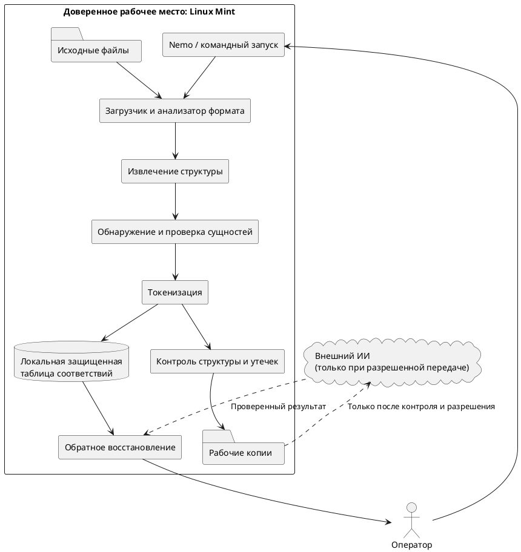

<!-- SYNTHETIC_DATE_FOR_DEMO -->
> **Условная дата:** дата этой статьи создана для демонстрационной хронологии сайта. Фактическая дата написания или публикации не подтверждена.


**Инженерная история локального инструмента подготовки документов к обработке средствами искусственного интеллекта**

> **Редакционный статус:** проект статьи на основании технического задания. Исходный код, история версий и протоколы испытаний не представлены. Поэтому приведенные архитектурные схемы, алгоритмы и команды являются проектными или иллюстративными, а не подтвержденными характеристиками готовой программы. Перед публикацией необходимо проверить их по репозиторию. Все организации, документы и параметры в примерах вымышлены.

## Аннотация

Современные языковые модели полезны при анализе договоров, технических заданий, программ и методик испытаний, спецификаций и других сложных документов. Однако исходные материалы могут содержать сведения, которые запрещено передавать во внешние сервисы. Простое удаление имен не решает проблему: конфиденциальная информация сохраняется в числах, взаимосвязях, метаданных и структуре документа. Кроме того, после обработки ИИ исправленный текст нередко требуется вернуть к исходным наименованиям и реквизитам.

В статье рассматривается инженерная постановка задачи локальной обратимой замены защищаемых сведений: требования, выбор архитектуры, обработка DOCX, PDF, TXT и Markdown, обнаружение сущностей, согласованная токенизация, защищенное хранение таблицы соответствий, восстановление, интеграция с Linux Mint и Nemo, угрозы и методика испытаний. Особое внимание уделено границам применимости: **обратимая псевдонимизация сама по себе не гарантирует анонимности и не является разрешением передавать документ во внешний ИИ**.

**Ключевые слова:** анонимизация; псевдонимизация; деанонимизация; конфиденциальность; техническая документация; локальная обработка; Linux Mint; Nemo; DOCX; PDF; языковые модели; тестирование.

## 1. С какой практической проблемы началась постановка задачи

Работа с технической документацией включает повторяющиеся операции: сопоставление требований и проверок, поиск противоречий между версиями документов, нормализацию терминологии, выявление пропущенных реквизитов, редактирование формулировок и построение матриц трассируемости. Средства искусственного интеллекта могут существенно ускорять эти операции. Препятствием становится не сложность запроса к модели, а содержание самого документа.

Например, договор, техническое задание и программа испытаний могут одновременно упоминать реальные организации, внутреннее обозначение изделия, параметры опытного образца, стоимость, даты и номера требований. Даже если фамилии и названия организаций заменить условными обозначениями, раскрытие характеристик изделия либо связей между документами может оставаться недопустимым.

Исходная инженерная задача формулируется следующим образом: **создать локальный механизм подготовки рабочей копии документа, при котором защищаемые значения заменяются согласованными маркерами, а восстановление исходных значений производится только в доверенной среде**.

Такой механизм должен решать две разные задачи. Первая — снизить объем раскрываемых сведений перед последующей обработкой. Вторая — сохранить полезность текста для анализа и возможность вернуть утвержденные правки в рабочую документацию. Между этими задачами возникает конфликт: чем больше деталей удалено, тем меньше контекста получает модель; чем больше контекста сохранено, тем выше риск косвенного раскрытия сведений.

Важно различать термины. В строгом смысле **анонимизация** предполагает, что связь данных с исходными субъектами не может быть практически восстановлена при заданной модели угроз. Если сохранена таблица обратной подстановки, речь идет об **обратимой псевдонимизации**, или токенизации. В названии проекта используется привычный термин «анонимизатор», но техническое описание должно опираться именно на это различие.

## 2. Как была сформулирована целевая модель работы

Базовый сценарий строится вокруг локального рабочего места под управлением Linux Mint. В качестве целевых форматов рассматриваются DOCX, PDF, TXT и MD. Интеграция с файловым менеджером Nemo предусмотрена как удобный способ запуска из контекстного меню; наличие готовой интеграции должно подтверждаться фактическими файлами программы.

Последовательность обработки в проектной модели следующая:

1. Оператор выбирает документ или согласованный комплект документов.
2. Программа создает рабочую копию, не изменяя оригинал, и определяет формат и структуру файла.
3. Из доступных текстовых и служебных областей извлекаются кандидаты на защищаемые сущности.
4. Оператор проверяет найденные совпадения и назначает правила обработки спорных участков.
5. Утвержденным сущностям присваиваются устойчивые маркеры в пределах заданной области действия.
6. Таблица соответствий сохраняется локально с предусмотренными механизмами защиты.
7. Подготовленный документ проходит структурную проверку и контроль на остаточные сведения.
8. Только после отдельного решения о допустимости передачи рабочая копия может быть использована во внешнем сервисе ИИ. Если такая передача запрещена, обработка остается локальной или не выполняется.
9. Возвращенный результат проверяется на неизвестные, поврежденные и утраченные маркеры.
10. Значения восстанавливаются из локальной таблицы соответствий; результат сохраняется отдельно и утверждается оператором.

Это **проектный сценарий**, а не заявление о том, что перечисленные десять операций уже реализованы.

### 2.1. Функциональные требования

| Код | Требование | Проверяемый результат |
|---|---|---|
| ФТ-01 | Принимать документы поддерживаемых форматов | Формат распознан, ограничения зафиксированы |
| ФТ-02 | Выявлять защищаемые значения и контекст их употребления | Сформирован перечень кандидатов с типами и местоположением |
| ФТ-03 | Позволять подтвердить или отклонить замену | Оператор управляет составом преобразований |
| ФТ-04 | Обеспечивать согласованную замену повторяющихся сущностей | Одна сущность получает один маркер в пределах заданной области |
| ФТ-05 | Сохранять обратное соответствие локально | Таблица привязана к конкретной сессии и версии схемы |
| ФТ-06 | Контролировать полноту удаления защищаемых значений | Экспорт блокируется при критическом остаточном совпадении |
| ФТ-07 | Восстанавливать утвержденные значения | Неизвестные токены выявляются, результат не подменяется молча |
| ФТ-08 | Не изменять исходные файлы | Исходный файл сохраняет первоначальную контрольную сумму |
| ФТ-09 | Формировать отчет об операции без исходных секретов | Журнал содержит коды результатов и диагностические признаки |
| ФТ-10 | Предоставлять удобный локальный запуск | Командный запуск или интеграция Nemo проверены отдельно |

Функциональное требование нельзя считать выполненным только потому, что в программе присутствует соответствующая функция. Нужны воспроизводимый входной пример, ожидаемый выход и протокол проверки.

### 2.2. Нефункциональные требования

Локальная обработка должна допускать работу без сетевого подключения, не изменять оригиналы, предсказуемо завершаться при сбое, исключать несанкционированную запись секретов в диагностические файлы и обеспечивать работу на выбранной версии Linux Mint. Предельный размер документов, допустимое время обработки и расход памяти устанавливаются по результатам измерений, а не на основании предположений.

Особенно важен принцип **безопасного отказа**: нераспознанная область документа, ошибка шифрования словаря, отсутствие ключа или неизвестный маркер должны приводить к блокировке небезопасного экспорта либо восстановления и к понятному сообщению оператору.

## 3. Почему архитектура должна быть локальной

При выборе архитектуры сравниваются три подхода: передача оригинала в облачный сервис, локальная подготовка документа с последующей разрешенной передачей очищенной версии и полностью локальная обработка с использованием собственных алгоритмов или локальной языковой модели.

| Подход | Преимущества | Основные ограничения |
|---|---|---|
| Передача исходного документа внешнему ИИ | Минимум предварительных операций, полный контекст | Потенциально недопустимое раскрытие исходных сведений; зависимость от правил сервиса |
| Локальная псевдонимизация перед внешним ИИ | Сохранение части логических связей; возможность обратной подстановки | Остаточные и косвенные признаки могут раскрывать чувствительные сведения |
| Полностью локальная обработка | Контроль вычислительной среды и сетевых потоков | Требования к ресурсам, сопровождению моделей и проверке качества |

Локальное исполнение анонимизатора — необходимое архитектурное ограничение, но не достаточное доказательство безопасности всей цепочки. Даже хорошо очищенный текст нельзя автоматически признавать пригодным для загрузки в публичную модель. Решение зависит от классификации информации, внутренних правил организации и модели угроз.

### 3.1. Разделение компонентов

Проектная архитектура предполагает независимые компоненты: загрузчик, анализатор формата, извлекатель содержимого, обнаружитель сущностей, механизм разрешения конфликтов, токенизатор, локальное защищенное хранилище, валидатор результата и модуль восстановления. Такое разделение позволяет отдельно тестировать ошибки чтения форматов, распознавания, подстановки и хранения.




*Рисунок 1 — Проектная компонентная схема; не является схемой, извлеченной из репозитория.*

Граница доверия проходит не только между локальным компьютером и облаком. Она разделяет также оригиналы, рабочие копии, секретную таблицу соответствий, временные файлы, резервные копии и диагностические журналы. Каждый элемент имеет собственные правила доступа и хранения.

## 4. Обработка форматов: почему обычной замены текста недостаточно

Наиболее сложная часть работы с технической документацией — не поиск слова, а сохранение смысловой и структурной целостности.

### 4.1. DOCX

Файл DOCX является контейнером взаимосвязанных частей. Текст может присутствовать не только в обычных абзацах, но и в таблицах, колонтитулах, примечаниях, сносках, гиперссылках, текстовых полях, свойствах документа и других компонентах. Внутри одного видимого слова могут находиться несколько фрагментов форматирования. Прямая замена по одному фрагменту не обнаружит сущность, разделенную между такими частями; грубое объединение текста способно разрушить форматирование или поля.

Поэтому проектная стратегия предусматривает анализ текстового потока с привязкой к структурным узлам, определение диапазона совпадения и внесение минимальных изменений в рабочую копию. После преобразования необходимо сравнить состав таблиц, абзацев, ссылок, рисунков, полей и других значимых элементов.

Отдельный риск создают комментарии, история исправлений, встроенные файлы и свойства документа. Отсутствие защищаемого слова на видимой странице не доказывает, что его нет в пакете DOCX.

### 4.2. PDF

Для PDF требуется различать документы с извлекаемым текстовым слоем, сканированные изображения и смешанные материалы. Поиск текста в PDF не равнозначен его надежному удалению. Визуальное перекрытие строк прямоугольником может сохранить исходные символы внутри файла. Аналогично извлечение текстового слоя может пропустить данные, присутствующие в рисунках, штампах и метаданных.

Безопасный путь для поддерживаемых PDF должен предусматривать реальное удаление или реконструкцию чувствительного содержимого, очистку сопутствующих данных и повторную проверку итогового файла. Если конкретный PDF не может быть надежно обработан, система должна отказать в экспорте, а не выдавать его за обезличенный.

Распознавание текста на изображениях (OCR) рассматривается как самостоятельная функция с собственными ошибками и ограничениями. **Поддержка PDF и поддержка сканированных PDF — не одно и то же.**

### 4.3. TXT и Markdown

Текстовые файлы проще с точки зрения структуры, однако требуют сохранения кодировки, переносов строк и специальных символов. В Markdown необходимо отдельно анализировать заголовки, таблицы, ссылки, адреса изображений, встроенный HTML и блоки кода. Замена внутри URL или программного фрагмента может нарушить работу ссылки либо изменить смысл примера.

Для каждого формата необходимы отдельные правила экспорта и проверки. Обобщенная отметка «формат поддерживается» должна означать конкретный перечень допустимых конструкций, а не способность открыть файл по расширению.

## 5. Обнаружение защищаемых сущностей

В исходных документах защищаемая информация неоднородна. Название организации требует одного способа обнаружения, адрес сервера — другого, а техническая характеристика изделия может быть конфиденциальной только в контексте конкретного проекта.

Проектируемый механизм обнаружения целесообразно разделить на несколько уровней:

- **Структурные признаки:** шаблоны реквизитов, адресов, идентификаторов, номеров документов и обозначений.
- **Словари проекта:** перечни организаций, сотрудников, изделий, подсистем и сокращений.
- **Контекстные правила:** сочетания терминов, соседние слова и тип документа.
- **Лингвистическая обработка:** падежные формы, сокращения, сложные наименования, омонимия.
- **Модельное распознавание:** локальное NER или иная языковая модель, если применение подтверждено реализацией и тестированием.

Программный модуль должен различать **кандидат на замену** и **утвержденное защищаемое значение**. Регулярное выражение может обнаружить последовательность, похожую на номер договора, но не определить, является ли этот номер секретным. Аналогично слово «Альфа» может обозначать организацию, испытательный коэффициент либо часть общеупотребительного выражения.

При пересечении кандидатов необходимо учитывать длину совпадения, класс сущности, правила приоритета, границы слов и решение оператора. Повторяющиеся упоминания одной сущности с разными падежными окончаниями не должны превращаться в несвязанные маркеры без специального основания.

Модель машинного обучения не следует представлять как обязательный элемент «интеллектуальности». Комбинация контекстных правил, проектных словарей, проверки конфликтов и контролируемого участия оператора также может составлять интеллектуальный механизм — но фактические алгоритмы должны быть подтверждены исходным кодом.

## 6. Как сохранить смысл документа при скрытии реквизитов

Рассмотрим учебный комплект из трех документов: договора, технического задания и программы и методики испытаний (ПМИ). Во всех трех фигурируют вымышленные организации ООО «Кромешные секреты» и АО «Абсолютно секретно», а также условное изделие КС-27.

**Исходный фрагмент договора (учебный пример):**

> ООО «Кромешные секреты» обязуется передать АО «Абсолютно секретно» изделие КС-27. Соответствие изделия требованию ТЗ-04 подтверждается испытанием ПМИ-07.

**Проектный результат псевдонимизации:**

> [ORG-0001] обязуется передать [ORG-0002] изделие [PRODUCT-0001]. Соответствие изделия требованию ТЗ-04 подтверждается испытанием ПМИ-07.

В техническом задании упоминание того же изделия должно получать маркер `[PRODUCT-0001]`, а не новый номер. При этом идентификаторы требований ТЗ-04 и проверок ПМИ-07 могут быть сохранены **только если они признаны допустимыми к раскрытию**. В противном случае для них назначаются собственные согласованные маркеры, причем связь между требованием и испытанием должна оставаться проверяемой.

| Вид сведения | Исходное учебное значение | Условный маркер | Правило |
|---|---|---|---|
| Организация-исполнитель | ООО «Кромешные секреты» | `[ORG-0001]` | Одинаков во всех документах установленной сессии |
| Организация-заказчик | АО «Абсолютно секретно» | `[ORG-0002]` | Отличается от маркера исполнителя |
| Изделие | КС-27 | `[PRODUCT-0001]` | Сохраняет связь договора, ТЗ и ПМИ |
| Требование | ТЗ-04 | `[REQ-0001]` при необходимости | Связано с испытанием |
| Проверка | ПМИ-07 | `[TEST-0001]` при необходимости | Связана с требованием |

*Таблица 1 — Демонстрационная таблица замен. В реальном применении такая таблица считается защищаемым материалом и не передается внешней модели.*

### 6.1. Пространство имен и область действия

Маркеры должны быть уникальны в пределах согласованной сессии обработки и однозначно соответствовать значениям. Для нескольких проектов необходима изоляция пространств имен; одинаковая строка маркера в двух разных словарях не должна создавать возможность ошибочного восстановления. Одновременно следует исключить случайное совпадение маркера с обычным текстом документа.

Избыточно подробное имя маркера само может раскрыть сведения. Обозначение класса `[PRODUCT-0001]` показывает существование отдельного изделия, а согласованные повторения позволяют восстановить граф взаимодействий. Если это недопустимо, требуется иная политика маскирования или отказ от внешней передачи.

### 6.2. Числа, сроки и формулы

Скрытие имен часто не скрывает главного. Предположим, учебное ТЗ содержит фразу: «Частота опроса — 80 Гц, допустимое отклонение — ±2 Гц». В зависимости от цели обработки возможны три решения:

1. Полностью заменить оба значения независимыми маркерами, если для задачи ИИ числовые значения не нужны.
2. Сохранить только обобщенные свойства: «номинальная частота и допустимое отклонение», если важна логика требований.
3. Использовать согласованное символическое представление, например «F ± ΔF», если требуется проверка структуры формулы без раскрытия чисел.

Нельзя произвольно заменять числа похожими числами, когда важны сумма, разность, соотношение или проверка диапазонов: такая подстановка может создать ложные результаты анализа. Если модель должна проводить вычисления, необходимо отдельно согласовать, какую часть числовой информации разрешено раскрывать.

### 6.3. Устойчивость маркеров при обработке ИИ

Модель может удалить маркер, изменить регистр, добавить пробелы, переименовать его или создать новый. Поэтому обратная подстановка не должна опираться на предположение, что внешний ответ всегда сохраняет идентификаторы.

Для проектного алгоритма предусмотрен контроль списка маркеров перед обработкой и после нее. Неизвестные идентификаторы блокируют автоматическое восстановление. Исчезновение или изменение числа вхождений само по себе не всегда является ошибкой: при сокращении текста часть сущностей может закономерно исчезнуть. Однако такие изменения должны фиксироваться и сопоставляться с характером разрешенной операции.

## 7. Таблица соответствий — наиболее чувствительная часть решения

Сохраненная связь «маркер — исходное значение» делает псевдонимизацию обратимой. Одновременно эта таблица становится концентрированным источником защищаемых сведений. Поэтому ее нельзя трактовать как вспомогательный технический файл.

Проектная запись словаря может содержать идентификатор сессии, маркер, класс сущности, исходное значение, допустимые формы записи, область применения, версию схемы и состояние проверки. При необходимости добавляются служебные идентификаторы исходных документов. Публикация заполненного рабочего словаря недопустима.

Для проектирования защиты рассматриваются аутентифицированное шифрование данных, надежное получение ключа из пароля, раздельное хранение ключевого материала и шифртекста, контроль прав доступа и резервное копирование. Примеры возможных примитивов — AES-GCM либо ChaCha20-Poly1305 для аутентифицированного шифрования и Argon2id для получения ключа из парольной фразы. **Назвать эти алгоритмы фактически примененными можно только после проверки кода, настроек и тестов.**

Безопасность не сводится к криптографической библиотеке. Отдельной проверки требуют:

- временные файлы, системные каталоги и кэш;
- журналы ошибок и диагностические сообщения;
- история команд оболочки и аргументы запуска;
- резервные копии, облачная синхронизация и обменные каталоги;
- дампы памяти и другие остаточные данные при соответствующей модели угроз;
- алгоритм восстановления после сбоя записи и версия формата словаря.

Если рабочий файл таблицы поврежден либо пароль недоступен, восстановление может стать невозможным. Поэтому стратегия хранения должна включать согласованное резервирование и проверку целостности. При этом резервная копия словаря требует не меньшей защиты, чем основной файл.

## 8. Обратная подстановка: восстановить текст недостаточно

Деанонимизация в проектируемой системе — самостоятельная операция с проверкой полномочий, целостности словаря и принадлежности маркеров заданной сессии. Иначе идентификатор из одного проекта может быть ошибочно заменен значением из другого.

Проектный алгоритм восстановления:

```text
Вход: обработанный документ, идентификатор сессии,
      разрешенный локальный словарь соответствий.

1. Проверить доступность словаря и его целостность.
2. Проверить принадлежность документа выбранной сессии.
3. Выделить все маркеры из обработанного документа.
4. Сопоставить их с разрешенным набором маркеров.
5. При неизвестном или неоднозначном маркере остановить
   автоматическое восстановление и сформировать ошибку.
6. Создать новую рабочую копию и выполнить подстановку.
7. Проверить синтаксис файла, его структуру и ссылки.
8. Сформировать отчет без включения раскрытых значений.
9. Передать результат оператору для окончательной проверки.
```

*Листинг 1 — Иллюстративный алгоритм; это не фрагмент реально проверенного исходного кода.*

Особую роль играет **смысловая целостность**. Предположим, ИИ изменил формулировку ТЗ-04 и одновременно предложил новую проверку ПМИ-07. После обратной подстановки названия организаций и изделия могут восстановиться безошибочно, но связь между требованием и испытанием оказаться нарушенной. Это не ошибка токенизатора, а риск последующего редактирования. Следовательно, требуется отдельная проверка матрицы «требование — метод проверки — ожидаемый результат».

Аналогичный контроль нужен для формул, ссылок на разделы, номеров таблиц, обозначений, единиц измерения и договорных обязательств. Формально корректное восстановление отдельных слов не гарантирует корректность документа в целом.

## 9. Интерфейс Linux Mint и интеграция с Nemo

Для инструмента, применяемого непосредственно при работе с файлами, эксплуатационный сценарий важен не меньше алгоритма. Целевой подход предусматривает обработку выделенных файлов через контекстное меню Nemo. При этом команды «Подготовить обезличенную копию» и «Восстановить значения» должны быть явно различимы, а результат — сохраняться в отдельных каталогах.

На уровне проектирования необходимы следующие меры: запрет перезаписи исходного документа, подтверждение неоднозначной операции, предварительный просмотр обнаруженных сущностей, контроль повторной анонимизации, понятные коды завершения и запись только обезличенной диагностики.

Интеграция Nemo может использовать файл действия `.nemo_action` и локальный исполняемый обработчик. Однако до ревизии репозитория нельзя приводить вымышленную команду запуска как готовую инструкцию. В окончательной публикации этот раздел должен быть дополнен реальными параметрами командной строки, расположением файлов интеграции, версиями зависимостей и снимками интерфейса без пользовательских данных.

## 10. Угрозы, которые не устраняет даже качественная замена сущностей

Главная ошибка при оценке подобных решений — предположение, что отсутствие исходных названий означает отсутствие раскрываемой информации. Анализируемый текст может содержать комбинации косвенных признаков, позволяющие определить область применения изделия, архитектуру системы, связи организаций, этап проекта и характер работы автора.

Наиболее значимы следующие группы рисков.

**Связи между объектами.** Повторяющиеся токены показывают, сколько существует организаций, изделий, подсистем и участников, как часто они взаимодействуют и какие обязательства между ними установлены.

**Редкие технические характеристики.** Даже при замене названия изделия необычное сочетание параметров, протоколов и условий эксплуатации может указывать на узкий класс решений.

**Временные закономерности.** Последовательности испытаний, интервалы разработки, сроки поставок и циклы обновлений позволяют строить предположения о состоянии проекта.

**Метаданные.** Авторы документов, изменения, скрытые комментарии, названия файлов, пути, встроенные изображения и служебные свойства способны сохранять исходные сведения.

**Междокументные корреляции.** Отдельные документы могут казаться безопасными, но их объединение дает дополнительную информацию. Например, договор раскрывает состав участников, ТЗ — функциональность, а ПМИ — реально проверяемые характеристики.

**Модельный вывод.** Внешняя ИИ-модель может не получать прямого соответствия токенов, но делать вероятностные выводы на основе сохранившегося текста. Поэтому анонимизатор должен уменьшать риск раскрытия, а не обещать математически гарантированную невозможность восстановления смысла.

Отдельная процедура допуска должна решать, какую информацию разрешено использовать вне доверенной среды. Для некоторых классов документов единственно допустимым вариантом остается полностью локальная обработка без отправки текста во внешние сервисы.

## 11. Как проверить, что инструмент действительно работает

Демонстрация одного удачного файла не подтверждает пригодность программы для технической документации. Испытания необходимо разделить на функциональные, отрицательные, структурные и эксплуатационные.

### 11.1. Учебный регрессионный набор

Тестовые документы должны быть полностью синтетическими, но воспроизводить реальные классы сложности: несколько типов сущностей, повторяющиеся названия, склонения, вложенные таблицы, форматированные фрагменты, гиперссылки, колонтитулы, метаданные, неподдерживаемые вложения, текстовые и сканированные PDF, смешанные кодировки и конфликтующие обозначения.

| Код испытания | Проверяемая ситуация | Критерий приемки | Статус |
|---|---|---|---|
| ИС-01 | Замена повторяющейся организации в нескольких документах | Согласованное обозначение во всех разрешенных контекстах | Требует запуска |
| ИС-02 | Сущность разбита на фрагменты форматирования DOCX | Совпадение распознано; структура и форматирование не повреждены | Требует запуска |
| ИС-03 | Защищаемое значение в колонтитуле или свойствах | Значение выявлено либо экспорт запрещен как неполный | Требует запуска |
| ИС-04 | Сканированный PDF без доступного OCR | Безопасный отказ или документированная полная обработка | Требует запуска |
| ИС-05 | Неизвестный маркер при восстановлении | Автоматическое восстановление блокируется | Требует запуска |
| ИС-06 | Поврежденный словарь либо неверный ключ | Секреты не раскрываются; выводится код ошибки | Требует запуска |
| ИС-07 | Сбой записи выходного файла | Оригинал остается неизменным | Требует запуска |
| ИС-08 | Попытка повторной обработки уже подготовленной копии | Обнаруживается конфликт либо предотвращается двойная замена | Требует запуска |
| ИС-09 | Секрет в комментарии, вложении или ссылке | Сведения обработаны либо экспорт запрещен | Требует запуска |
| ИС-10 | Работа при отключенной сети | Заявленные локальные функции работают при фиксированном окружении | Требует запуска |
| ИС-11 | Редактирование текста моделью с потерей маркера | Расхождение фиксируется; неверная подстановка не выполняется | Требует запуска |
| ИС-12 | Проверка оригинала после всех операций | Контрольная сумма исходного файла не изменена | Требует запуска |

*Таблица 2 — Предлагаемая программа проверок; результаты испытаний в исходном задании отсутствуют.*

### 11.2. Показатели качества

Для измерения качества распознавания нужен размеченный эталон. **Точность** определяется как доля правильных обнаружений среди всех обнаружений: `TP / (TP + FP)`. **Полнота** — как доля найденных защищаемых сущностей среди всех сущностей эталона: `TP / (TP + FN)`. Отдельно учитываются ложные срабатывания, пропуски, ошибки определения границ сущности и ошибки классификации.

Обобщенная цифра без разделения по классам малоинформативна: программа может хорошо находить адреса электронной почты, но пропускать внутренние названия компонентов и значения в таблицах.

Также следует измерять долю успешно восстановленных маркеров, количество структурных расхождений, время обработки, максимальный расход памяти и количество отказов. Для показателей производительности обязательно указываются версия программы, конфигурация рабочего места, размеры файлов и особенности тестовых данных.

### 11.3. Проверка локальности исполнения

Утверждение «данные никуда не отправляются» нельзя доказывать только тем, что программа запускается без браузера. Необходимы анализ зависимостей, контроль системных вызовов или соединений, выполнение на изолированном стенде, проверка журналов и наблюдение при типовых и ошибочных сценариях.

Даже успешный тест без доступа к сети подтверждает лишь работоспособность в заданных условиях. Он не доказывает отсутствие всех возможных сетевых функций во всех версиях и конфигурациях программы. Корректная формулировка результатов должна указывать границы наблюдения.

## 12. Как оценивались инженерные альтернативы

В основе разработки лежит не выбор одной «лучшей» библиотеки, а серия компромиссов.

| Проблема | Альтернативы | Проектное направление и основание |
|---|---|---|
| Скрытие имен с сохранением связей | Удаление; подмена случайными словами; устойчивые маркеры | Согласованные маркеры позволяют анализировать структуру связей; повышают риск корреляции |
| Конфиденциальные числа | Оставить; заменить произвольно; удалить; обобщить | Политика замены определяется задачей анализа и допустимостью раскрытия |
| Поиск сущностей | Шаблоны; словари; локальная модель; комбинированный подход | Комбинация методов требует отдельной проверки качества каждого класса |
| Работа с DOCX | Простая замена текста; структурное редактирование | Структурное редактирование необходимо для сохранения элементов документа |
| Работа с PDF | Закрасить визуально; удалить содержимое; реконструировать документ | Визуальное перекрытие не считается безопасным удалением |
| Хранение соответствий | Открытый текст; шифрованный локальный словарь | Защита словаря обязательна для реальных секретов; механизм требует подтверждения |
| Неоднозначное обнаружение | Автоматически заменить; запросить решение оператора | Предпочтительны подтверждение и безопасный отказ |
| Эксплуатация | Только командная строка; графический интерфейс; Nemo | Контекстное меню удобно, но требует защиты от неправильного запуска |

*Таблица 3 — Матрица проектных альтернатив. Фактическое принятое решение по каждой строке устанавливается после ревизии исходников.*

В инженерной статье особенно ценен разбор реальных неудачных подходов. Например, повреждение форматирования при замене DOCX, конфликт двух маркеров или невозможность корректного восстановления после переписывания текста моделью могут объяснить переход к иной архитектуре. **Однако конкретные инциденты нельзя включать в историю разработки без подтверждения журналом, тестом или изменением кода.**

## 13. Что считать результатом разработки

Для подобного проекта существует как минимум три разных результата.

**Результат анализа** — сформулированные требования, классификация защищаемых сущностей, модель угроз и критерии допустимой обработки. Это самостоятельный инженерный продукт, даже если программная реализация находится в развитии.

**Результат проектирования** — компоненты системы, правила токенизации, модель данных словаря, политика ошибок, сценарии интерфейса и программа испытаний. Эти материалы позволяют контролируемо реализовывать и расширять решение.

**Результат программирования и испытаний** — конкретная версия исходного кода, проверенные команды, протоколы тестов, метрики и перечень фактических ограничений. Только на основании этой третьей группы допустимо утверждать, что функция реализована и работает.

В исходном техническом задании зафиксированы цель, целевые форматы, локальная среда и требуемые этапы проверки. Однако **не приведены версия программы, дерево модулей, репозиторий, фактические примененные библиотеки, схема шифрования и результаты запусков**. Эти пробелы подлежат заполнению на основании проверенных материалов, а не предположений.

## 14. Ограничения и направления развития

Для дальнейшей работы над проектом сформирован набор направлений. Это **дорожная карта**, а не перечень готовых возможностей.

**Первый приоритет — подтверждение безопасного базового контура.** Необходимы инвентаризация кода, тесты сохранности оригинала, проверка хранения ключей, защита от пропущенных секретов и воспроизводимый набор TXT/MD с простыми структурами.

**Второй приоритет — промышленная пригодность документов.** Предусматривается расширение покрытия DOCX, обработка сложных объектов, отдельная стратегия PDF, регрессионные тесты структуры, проверка метаданных и конфигураций.

**Третий приоритет — повышение качества обнаружения.** Возможны локальные языковые модели, NER, морфологическая нормализация, улучшенный просмотр сомнительных совпадений и измерение точности/полноты по классам сведений.

**Четвертый приоритет — эксплуатация и масштабирование.** Рассматриваются интерфейс Nemo, отдельный графический режим, пакетная обработка, более подробные отчеты, управление версиями словарей и политика взаимодействия с внешними ИИ.

Основные ограничения следует публиковать отдельно от дорожной карты: сканированные документы без надежного OCR, непроанализированные встроенные объекты, неоднозначные русскоязычные наименования, сохранение косвенных признаков и отсутствие статистически достаточного тестового охвата не могут быть скрыты общей формулировкой «поддержка документов».

## 15. Воспроизводимая демонстрация вместо неподтвержденных обещаний

Практическое подтверждение работоспособности должно включать открытый учебный пакет с вымышленными документами и эталонными результатами. Минимальный состав демонстрации:

```text
demo/
├── README.md
├── requirements-and-limits.md
├── input/
│   ├── contract-sample.md
│   ├── specification-sample.md
│   ├── tests-program-sample.md
│   ├── sample.docx
│   └── sample.pdf
├── expected/
│   ├── tokens-reference.md
│   ├── anonymized-reference.md
│   └── restored-reference.md
├── checks/
│   ├── test-cases.md
│   └── results-template.md
└── diagrams/
    └── architecture.puml
```

*Рисунок 2 — Предлагаемая структура демонстрационного пакета; перечисленные файлы не заявляются созданными в рамках данной статьи.*

В окончательной версии пакета должны присутствовать точные версии зависимостей, проверенная команда запуска, ожидаемые результаты, сведения о лицензиях компонентов, инструкция по выполнению тестов и указание функций, которые пока не поддерживаются. Предоставлять реальные ключи, рабочие таблицы соответствий и документы ограниченного доступа недопустимо.

## Заключение

Разработка локального анонимизатора технической документации показывает, почему задача замены конфиденциальных фрагментов значительно шире обычного поиска и замены строк. Необходимо одновременно учитывать формат документа, связанность сведений, контекст распознавания, непротиворечивость маркеров, криптографическую защиту локальных соответствий, качество обратной подстановки и риск косвенного раскрытия информации.

Главный проектный принцип состоит в том, что **полезность текста для ИИ не должна достигаться ценой неконтролируемой передачи защищаемых сведений**. Обратимая псевдонимизация рассматривается как один из технических механизмов снижения риска; окончательное решение о допустимости обработки зависит от содержания, классификации данных и применимых ограничений.

Итоговая оценка инструмента должна основываться не на обещании «полной анонимности», а на прозрачных границах применения, проверенном исходном коде, воспроизводимых испытаниях и документированных отказах. Именно такое сочетание системного анализа, программирования, технического документирования и проверки безопасности превращает локальный скрипт из частной автоматизации в управляемый инженерный проект.

---

## Редакционное приложение А. Сведения, обязательные к подтверждению перед публикацией

Этот раздел предназначен для подготовки окончательной версии и **не публикуется как часть статьи**.

| Утверждение или материал | Что требуется приложить | Текущий статус |
|---|---|---|
| История возникновения задачи и реальные этапы разработки | Датированные записи, коммиты, рабочие заметки | Не подтверждено представленным XML |
| Текущая версия и язык реализации | Репозиторий, конфигурация сборки, журнал изменений | Не подтверждено |
| Поддержка DOCX/PDF/TXT/MD | Код адаптеров, матрица покрытия, тестовые файлы | Только целевые форматы |
| Способ обнаружения сущностей | Код правил, словари, конфигурация, модель при наличии | Не подтверждено |
| Согласованная токенизация | Фрагмент реального кода и регрессионный тест | Проектное описание |
| Зашифрованная таблица соответствий | Примененная библиотека, алгоритм, ключи без секретного материала, тесты | Заявлено как целевое свойство |
| Возможность деанонимизации | Код, протоколы штатных и аварийных сценариев | Не подтверждено |
| Работа через Nemo | Реальный `.nemo_action`, обработчик, снимки меню | Целевой сценарий |
| Отсутствие сетевых передач | Анализ исходников, зависимостей, условия наблюдения и протоколы | Не подтверждено |
| Сохранение структуры и неизменность исходников | Тестовые контрольные суммы и структурные сравнения | Не подтверждено |
| Показатели качества, скорости и памяти | Эталонная разметка, стенд, результаты измерений | Измерения не предоставлены |
| Неудачные решения и история исправлений | Issues, коммиты и регрессионные тесты | Не подтверждено |

После получения исходного кода следует заменить проектные формулировки подтвержденными фактами, добавить реальные листинги, фактическую схему компонентов, номера версий, результаты тестов и уточнить название статьи с учетом фактической стадии проекта.

## Редакционное приложение Б. Проверка материала перед выпуском

- [ ] Реальная история подтверждена датами и материалами проекта.
- [ ] Все заявления о работоспособности подтверждены запуском или тестом.
- [ ] Проектные возможности не названы реализованными.
- [ ] Диаграммы соответствуют действительной структуре программы.
- [ ] Листинги скопированы из проверенного кода, а не из иллюстративных образцов.
- [ ] Демонстрационные документы полностью синтетические.
- [ ] Рабочие токены, исходные защищаемые значения и ключи отсутствуют.
- [ ] Файловые пути и метаданные не раскрывают сведения пользователей.
- [ ] Названы фактические ограничения DOCX и PDF.
- [ ] Утверждения о сетевой автономности ограничены условиями испытаний.
- [ ] В Wordmaster добавлены ссылки на статьи «До и после анонимизации» и «Как ИИ восстанавливает косвенные признаки», когда эти материалы действительно опубликованы.
- [ ] Страница проверена на настольном компьютере и Android.


## Связанные публикации

- [Подготовка документов к обработке ИИ](/alsibir-expert/blog/ai/document-anonymization/)
- [Цикл обезличивания документов](/alsibir-expert/blog/security/01_anonymization_cycle/)
