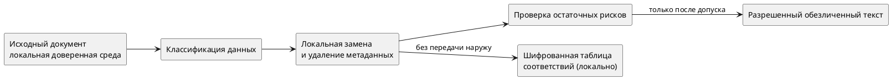

**Направление:** ИИ, техническое документирование, информационная безопасность · **Актуализация:** 09.10.2026.

ИИ может помогать структурировать требования, сравнивать редакции, улучшать язык, формировать таблицы и выявлять противоречия. Однако технические документы часто содержат персональные данные, служебные адреса, параметры систем, коммерческие условия и сведения, подпадающие под договорные ограничения. Перед передачей текста внешней системе необходимо оценить **не только прямые идентификаторы, но и возможность их косвенного восстановления**.

## 1. Термины, которые нельзя смешивать

- **Удаление идентификаторов:** исключение отдельных имен, адресов и номеров из текста. Само по себе недостаточно для гарантии обезличивания.
- **Псевдонимизация:** замена значения устойчивым обозначением с сохранением таблицы соответствий. При наличии таблицы обратное восстановление возможно.
- **Обезличивание (деидентификация):** меры, направленные на снижение возможности связать данные с конкретным субъектом. Остаточный риск повторной идентификации может сохраняться.
- **Редакционная маскировка:** замена чувствительного фрагмента на безопасное описание; при необходимости теряется часть технической полезности.

Для реальной системы эти операции требуют отдельной модели угроз и правовой оценки применимого режима данных.

## 2. Классы сведений в технической документации

| Класс | Примеры | Риск при передаче во внешнюю систему |
|---|---|---|
| Прямые идентификаторы | ФИО, телефон, e-mail, ИНН | Прямая идентификация лиц и организаций |
| Сетевые и технологические параметры | IP-адреса, домены, топология, порты | Раскрытие особенностей инфраструктуры |
| Договорные сведения | Цена, номер контракта, сроки, перечень сторон | Раскрытие коммерческих отношений |
| Технические секреты | Алгоритмы, ключи, внутренние настройки | Компрометация защищаемых сведений |
| Косвенные признаки | Редкая комбинация ОС, сроков, отрасли и географии | Повторная идентификация по совокупности |
| Метаданные файла | Автор DOCX, комментарии, скрытые элементы | Утечка через содержимое контейнера |

## 3. Архитектура безопасной предобработки

Ниже приведен **концептуальный** поток. Его недостаточно для доказательства безопасности конкретной реализации.




Перед использованием облачной модели требуется отдельно проверить ее условия обработки и хранения данных, возможность использования материалов для обучения, трансграничную передачу, журналирование, права доступа и договорные ограничения заказчика. **Безопасная локальная предобработка не делает любую последующую передачу автоматически допустимой.**

## 4. Демонстрационный пример «до — после»

**До обработки (полностью вымышленные данные):**

> АО «Проект Альфа» внедряет систему диспетчеризации на объекте «Север-17». Администратор И. И. Примеров выполняет проверку шлюза `10.12.14.8` до 31.10.2026.

**После локальной подстановки:**

> `[ОРГ_001]` внедряет систему диспетчеризации на `[ОБЪЕКТ_001]`. Администратор `[СОТР_001]` выполняет проверку шлюза `[УЗЕЛ_001]` до `[ДАТА_001]`.

**Фрагмент локальной таблицы соответствий, не предназначенный для выгрузки:**

```text
[ОРГ_001]    → АО «Проект Альфа»
[ОБЪЕКТ_001] → «Север-17»
[СОТР_001]   → И. И. Примеров
[УЗЕЛ_001]  → 10.12.14.8
[ДАТА_001]  → 31.10.2026
```

Этот пример показывает механизм подстановки, но не доказывает стойкости к повторной идентификации. Даже без прямых названий описание редкой системы и характера объекта может позволить сделать обоснованные предположения.

## 5. Какие выводы возможны по косвенным признакам

Читатель обезличенного текста способен сопоставлять частоту упоминаний функций, последовательность согласования, объем документации, названия протоколов, специфические комбинации ПО и требований. Отсюда потенциально восстанавливаются **отрасль, примерный тип заказчика, технологический стек, зрелость процессов, организационная структура и вероятные ограничения проекта**.

Это именно *вероятностные выводы*, а не доказательство личности контрагента. Чем больше внешних данных и чем уникальнее признаки, тем выше риск. Поэтому нужны не только словарные замены, но и анализ контекста, редких признаков, перекрестных документов и метаданных.

## 6. Контрольный контур публикации

1. Классифицировать документ и определить допустимость работы с ИИ согласно политике владельца данных.
2. Удалить прямые идентификаторы, секреты, встроенные объекты, историю исправлений и опасные метаданные.
3. Провести контекстную проверку: названия проектов, уникальные события, даты, редкие конфигурации.
4. Проверить полученный материал на обратимость и возможность корреляции с публичными источниками.
5. Передавать в модель только минимально необходимый фрагмент при наличии разрешения.
6. Проверить результат ИИ на вымышленные факты и восстановление исключенных сведений.
7. Выполнить обратную подстановку только в доверенной среде и повторный контроль перед сохранением.
8. Сохранить журнал процедуры без исходных секретов; защитить локальную таблицу соответствий шифрованием и разграничением доступа.

**Для сведений, составляющих государственную тайну, режим определяется специальными требованиями и разрешенными средствами обработки.** Обычное обезличивание не является основанием для отправки таких сведений в внешние ИИ-сервисы.

## Вывод

Профессиональное использование ИИ в документировании предполагает управление потоком сведений, а не только выбор удачного запроса. Основной критерий — возможность объяснить, какие данные отправлялись, на каком основании, какие риски сохранены и какие проверки выполнены.

## Источники

1. [NIST IR 8053: De-Identification of Personal Information](https://csrc.nist.gov/Pubs/ir/8053/Final).
2. [NIST: De-Identifying Government Datasets — Techniques and Governance](https://www.nist.gov/publications/de-identifying-government-datasets-techniques-and-governance).
3. [OWASP API Security Top 10 — 2023](https://api-security.owasp.org/editions/2023/en/0x11-t10/) — контекст защиты интерфейсов обработки данных.

*Все сведения в примерах вымышлены. Материал не является заключением о соответствии конкретной системы требованиям законодательства об информации или персональных данных.*
